# AlgoViz · DARK-DIAGRAM-01 教学图解深色主题适配审计

日期：2026-11-25

基线：`main` / `5bb4083`

发布边界：`v1.0.0` 已发布，Tag 对象 `bb55247a9712bc04644cdb274efde6a8101a2169`，解引用目标 `52498964fea4689e5add732080638a4a9443fa7c`。本轮是发布后维护，不移动 Tag，不创建 Release。

## 1. 结论

- 本轮覆盖 116 个教学页：56 个静态理论专题页、60 个可运行算法页；同时核对全屏工作区、缩放、主题切换与 5 档视口。
- 56 个静态专题页的图解框架保持透明，SVG 中没有白色 `fill`。唯一静态侧问题是 `array-basics` 交互选中态仍使用固定浅黄；已修复。
- 60 个算法页的首帧深色审计中，修复前有 13 页命中白色 SVG 填充或面积超过 4,000 px² 的白色子表面；修复后 60/60 均为 0。
- 未采用 `filter: invert(1)` 或全局反色。浅色主题的原有配色不删除、不改写；深色主题由新的 token 化覆盖层重映射。
- 修复覆盖文件结构、查找、排序、外部排序、广义表、B 树、数组交互等图解族。节点坐标、算法布局、Python Trace、课程注册表、参考代码和缩放数学逻辑均未修改。

## 2. 审计范围与方法

### 2.1 页面与组件

| 类型 | 数量 | 说明 |
| --- | ---: | --- |
| 静态理论专题页 | 56 | `concept:*`，由 `ConceptDiagram` 分派到 15 个静态图解组件 |
| 可运行算法页 | 60 | 首帧深色渲染，包含真实 Pyodide Trace |
| 动态视觉组件文件 | 22 | `src/features/lab/*Visual.tsx` |
| 本轮代表截图页 | 8 | 文件索引、B+ 树、键树、锦标赛树、多路归并、倒排索引、广义表、数组选中态 |
| 视口矩阵页 | 3 × 5 × 2 | `file-index`、`tournament`、`gl-depth`，浅色/深色各 360、390、768、1280、1440 px |
| 全屏与缩放页 | 1 | `file-index`，100%、200%、50%，退出后继续核对主题 |

### 2.2 检查层次

1. 源码扫描。检索章节 CSS 与组件中的 `background`、`background-color`、`fill`、`stroke`、`#fff`、`white`、`var(--legacy, #...)`。源码扫描只用于定位候选，不作为“已修复”的依据。
2. 浏览器计算值。用 Playwright + Microsoft Edge 在真实页面读取每个图解子元素的 `backgroundColor`、SVG `fill`、`stroke` 和实际面积。
3. 截图复核。对白色面积、局部亮块、节点状态、文字和连线做实际截图检查，不依赖 DOM 颜色断言替代视觉判断。
4. 主题与交互回归。切换浅色/深色、全屏、200% 放大、50% 缩小、退出全屏，检查帧位置和主题一致性。

### 2.3 “修复前”截图如何取得

修复前截图不是历史遗留截图，而是用当前代码关闭 `diagram-theme-dark.css` 样式表，并把本轮新增的共享别名恢复为旧版的 guaranteed-invalid 初值后重新截取。这样能重现“没有深色覆盖层、没有新别名”的实际渲染，同时保持页面、帧和视口完全一致，便于逐像素对照。

## 3. 问题清单

优先级仅用于本轮主题适配，不代表 v1.0.0 的发布安全等级。

“浅色表现”是当前浅色主题的实际效果；“深色表现（修复前）”是本轮修复前的实际效果。

### 3.1 P1 — 大面积白底、关键文字或连线不可读

| ID | 页面 / 组件 / 章节 | 浅色表现（当前） | 深色表现（修复前） | 硬编码背景 | 文字对比度 | 连线 | 异常填充 | 修复方案 | 状态 |
| --- | --- | --- | --- | --- | --- | --- | --- | --- | --- |
| DD-P1-01 | 多章节共享别名；第 5、8、9、10、11、12 章 | 多数属性依靠 `var(--legacy, 回退值)` 仍能显示，但边框和次要文字偏浅 | `--line`、`--ink`、`--text`、`--text-muted`、`--surface-soft`、`--positive*` 等未声明；文字回退到 `#1f2328`，边框回退到 `#d8d8d8`。深底黑字和浅灰线造成低对比、部分连线消失 | 是（章节 CSS 的回退值） | 低，部分不可读 | 浅灰边线在深色背景上明显变弱，部分不可见 | 无白色填充，但边框语义丢失 | 在 `tokens.css` 的深/浅主题中同时补齐共享别名；深色层只引用 token 或 `color-mix(... token ...)` | 已修复 · 已验证 |
| DD-P1-02 | `file-index`（索引文件）；`.file-block`、`.file-path`、`.file-record`；第 12 章 | 白色块卡、浅灰索引条，层次清晰 | 3 个文件块各约 17,147 px² 保持白底，路径条约 18,002 px²；索引项和记录条继续使用近白背景。深色页面中出现整组白色文件卡 | 是：`#fff`、`#fbfcfd`、`#fafbfc` | 黑字落在白底上可读，但与外围深色页面产生大面积眩光；较小记录条同样为白底 | 文件块边框回退为浅灰，边界感减弱 | 是，整块白色子表面 | 文件块、路径、索引项、记录和结果框改为 `--panel` / `--panel-2`；选中、扫描、命中保留 token 化强调 | 已修复 · 已验证 |
| DD-P1-03 | `isam`（ISAM 文件）；`.isam-block`、`.isam-overflow-node`、`.file-record`；第 12 章 | 白色主数据块、浅灰索引、紫色溢出链 | 3 个主数据块各约 29,574 px² 为白色；溢出节点和索引项仍为浅色，主数据区与溢出链在深色下形成成片亮区 | 是：`#fff`、`#fbfcfd`、`#f0ecfb` | 白底黑字本身可读，但页面整体亮暗跳变明显；次要地址与容量文字偏灰 | 主块边框浅灰；溢出链的紫色关系在白色块之间不够突出 | 是，主块和溢出节点均为浅色填充 | 主块、索引、记录和溢出节点改深色面板；溢出链用 `--diagram-violet` 的 token 化强调，`has-overflow` / `is-current` 保留语义 | 已修复 · 已验证 |
| DD-P1-04 | `inverted-index`（倒排索引）；`.inverted-record`、`.inverted-term`、`.inverted-query-terms`、`.inverted-match-box`；第 12 章 | 白/浅灰记录、词条、查询词和结果框；AND/OR 说明清楚 | 4 条记录各约 5,154 px²、4 个词条各约 7,892 px²、查询区约 14,299 px²、结果框约 20,429 px² 均为白色/近白色。深色页面中出现多个亮块 | 是：`#fff`、`#fbfcfd`、`#f6f8fa` | 黑字在白底可读；结果数字和匹配词在白块上正常，但与深色面板不协调 | 词条箭头、集合关系线和“空列表”说明在白色块周围对比不足 | 是，多个白底子表面 | 记录、词条、查询和匹配框改为深色面板；`is-current`、`is-matched` 使用绿色 token，AND/OR 说明保持 `--muted` | 已修复 · 已验证 |
| DD-P1-05 | `block-search`（分块查找）；`.search-visual-head`、`.block-row`、`.block-cell`；第 9 章 | 白色索引头和白色数据块行，表格边界清楚 | 索引头约 20,661 px²、3 个块行各约 27,800 px² 为白色/近白色；单元格在白底上保持浅灰。深色页面中出现三整条白色表格 | 是：`#fff`、`#f6f8fa`、`#fbfcfd` | 黑字白底可读；但深色主题下大面积白行造成眩光，块标题的灰色文字偏弱 | 行边框和块内分隔线为浅灰，白色行之间层次清楚，但深色页面边界消失 | 是，整行白色子表面 | 索引头、块行、单元格改为 `--panel` / `--panel-2`；`is-active`、`has-match`、`is-compared`、`is-matched` 使用 token 化边线和填充 | 已修复 · 已验证 |
| DD-P1-06 | `bplus-tree`（B+ 树）；`.bplus-canvas-scroll`、`.bplus-node rect`、`.bplus-node text`；第 9 章 | 白/极浅画布、白节点、浅色网格，叶链与指针清楚 | 画布约 167,640 px² 为 `#fcfcfd`，5 个节点矩形为白色；深色模式下整块画布成为大面积白色区域，只有外围面板保持深色 | 是：`#fcfcfd`、`#fff`、`#c7ccd2` | 节点文字为深色，在白节点上可读；画布大面积白色使“深色模式”失效 | 节点连线和叶链在白色画布上为浅灰，换到深色后如果只改背景会消失 | 是，整块画布和节点填充 | 画布改为 `--panel-2` + token 网格；节点用 `--graph-node` / `--graph-node-edge`，连线用 `--graph-line`，路径、叶链、分裂和提升分别映射到语义 token | 已修复 · 已验证 |
| DD-P1-07 | `key-tree`（键树 / Trie）；`.key-tree-canvas`、`.key-tree-dictionary`、`.key-tree-node-circle`；第 9 章 | 极浅画布、白色词典卡、白色节点圆，词典和路径清楚 | 画布约 148,520 px² 为 `#fcfcfd`，词典约 33,570 px² 为 `#fff`，9 个节点圆为白色；深色页面上画布与词典形成两块大面积亮区 | 是：`#fcfcfd`、`#fff`、`#c7ccd2` | 节点字符为深色，在白圆上可读；词典说明和路径标签在深色下依赖失效别名 | 树枝连线为浅灰，深色下对比不足；当前路径和命中节点没有稳定的深色语义 | 是，画布、词典、节点圆 | 画布和词典改为深色面板；节点圆用 `--graph-node`，当前、创建、命中、路径分别映射 `--warn`、`--accent`、`--positive`、`--accent-2`；连线用 `--graph-line` | 已修复 · 已验证 |
| DD-P1-08 | `multiway`（多路归并）；`.ext-run`、`.ext-bucket`、`.ext-chip`、`.ext-input-tape`；第 11 章 | 浅色归并段、白色桶和浅灰磁带，阶段层次清楚 | 2 个归并段各约 36,542 px²、桶约 8,924 px² 为白色/近白色；输入磁带和 chip 继续保持浅色，深色页面中出现大面积白色归并区 | 是：`#fbfcfd`、`#f7f8fa`、`#fff` | 深色文字在白底上可读；已读/冻结/当前等状态色在白底上失去深色主题一致性 | 归并流向箭头、缓冲区指向线和阶段边框依赖浅色底，深色下对比变弱 | 是，归并段、桶和磁带 | 归并段/桶/候选/槽改为 `--panel-2`，chip 用 `--panel`；当前、已完成、冻结、候选等状态用 `--warn`、`--accent`、`--red` 的 `color-mix` 填充；流向箭头改为 `--warn` | 已修复 · 已验证 |

### 3.2 P2 — 局部亮块明显、次要文字或语义色失衡

| ID | 页面 / 组件 / 章节 | 浅色表现（当前） | 深色表现（修复前） | 硬编码背景 | 文字对比度 | 连线 | 异常填充 | 修复方案 | 状态 |
| --- | --- | --- | --- | --- | --- | --- | --- | --- | --- |
| DD-P2-01 | `tournament`（锦标赛树）；`.sort10-node rect`、`.sort10-node text`、`.sort10-tree line`；第 10 章 | 白色节点、深色文字、浅色树线，树结构清楚 | 15 个节点矩形保留白色填充，深色树面板中出现一组白色节点；文字为深色，白底可读，但节点与深色背景的亮度反差过大 | 是：节点 `fill: #fff` | 节点文字本身可读；节点编号和空槽文字偏灰 | 树线为浅灰色，深色面板上尚可见，但当前路径与受影响路径的强调不够 | 是，15 个白色节点填充 | 节点改为 `--graph-node`，文字 `--graph-text`；当前、比较、受影响、移出、补位分别用 `--warn`、`--accent-2`、`--accent`、`--panel-2`、`--edge`；树线用 `--graph-line` | 已修复 · 已验证 |
| DD-P2-02 | `radix`（基数排序）；`.sort10-bucket`、`.sort10-bucket-head`；第 10 章 | 10 个浅灰桶、浅色桶头、深色数字 | 10 个桶各约 9,305 px² 为 `#fbfbfc`，在深色页面中形成 10 个成片浅色块；桶头为浅灰 | 是：`#fbfbfc`、`#f7f8fa` | 桶内数字为深色，浅底可读；桶头标签的对比在浅底上正常，但在深色主题中像另一套配色 | 桶边框浅灰；桶与桶之间的分隔在深色下几乎消失 | 是，10 个桶的浅色填充 | 桶改 `--panel-2`，桶头使用 `--tag-bg` / `--tag-fg`；活动桶使用 `--tag-orange-bg` / `--tag-orange-fg`；桶边框 `--edge`，活动边框 `--warn` | 已修复 · 已验证 |
| DD-P2-03 | `replacement`（置换选择）；`.ext-workspace-slot`、`.ext-tape-record`、`.ext-candidate`；第 11 章 | 浅灰工作区槽、白色磁带记录、浅色候选 | 3 个工作区槽各约 6,068 px² 为近白色；磁带记录和候选继续为浅底，深色工作区出现多个白色小块 | 是：`#fafbfc`、`#fff`、`#f9fafb` | 记录数字可读；候选说明和槽索引使用灰色，深色下偏弱 | 槽位虚线、磁带进度线和候选关系线以浅灰为主，深色下边界弱 | 是，工作区槽和记录条 | 槽位/候选/磁带记录改为 `--panel` / `--panel-2`；已读、冻结、当前、完成分别保留语义强调；进度线改 `--panel-2` / `--accent` | 已修复 · 已验证 |
| DD-P2-04 | `optimal-merge`（最佳归并树）；`.ext-node rect`、`.ext-tree line`、`.ext-weight-chip`；第 11 章 | 白色节点、浅色权值 chip、浅灰树线 | 4 个树节点矩形保留白色填充；权值 chip 和根说明仍为浅色，深色面板中出现白色节点 | 是：节点 `fill: #fff`、chip `#f9fafb` | 节点文字可读；权值 chip 文字在白底上可读，但色块与深色面板不协调 | 树线浅灰，深色下可见度一般 | 是，4 个节点填充 | 节点用 `--graph-node` / `--graph-node-edge`，树线 `--graph-line`；叶子、内部、虚拟、选中、新建节点分别用 accent/warn/red 的 token 混合；权值 chip 改 `--panel-2` | 已修复 · 已验证 |
| DD-P2-05 | `gl-depth`、`gl-copy`（广义表深度/复制）；`.gl-node-box`、`.gl-node-label`、`.gl-ledger`、`.gl-done-banner`；第 5 章 | 浅色节点（带少量蓝/黄/绿强调）、深色标签、浅色账本，结构清楚 | 每页 9 个 `.gl-node-box` 矩形保留 `#f4f7fb/#eef2f7/#fff2d3/#e7f0ff/#e8f6ee` 等固定浅色；深色树面板中出现 9 个白色/浅色节点，节点标签虽可读但整组节点过亮 | 是：多组浅色节点填充 | 节点标签为深色；在浅色节点上可读，但账本状态和完成横条的深色文字与深色面板产生不一致 | 树边为浅灰，深色下可见但当前节点、父节点、已完成节点的边线语义不够突出 | 是，每页 9 个白色/浅色节点填充 | 节点统一为 `--graph-node`；原子、列表、当前、父、已完成/复制、空节点分别映射到 token 化填充；账本行、公式和完成横幅改深色面板与 positive token | 已修复 · 已验证 |
| DD-P2-06 | `concept:array-basics`（数组存储）；`.array-cell.is-selected`、`.array-memory-slot.is-selected`、`.array-address`；第 2 章 | 浅黄选中格、深棕文字、绿色地址，交互反馈明确 | 选中格固定为 `#fff2d3`，选中索引为 `#8a5b00`，地址为固定 `#2f6f4e`；深色页面中选中格成为孤立浅色块，地址在深色背景上偏暗 | 是：`#fff2d3`、`#6b4700`、`#2f6f4e` | 选中格内深字可读，但该格与页面主题割裂；地址绿色对比不足 | 选中边框 `#b97800` 在深色下偏暗，强调不够 | 是，选中格浅黄填充 | 选中格改为 `--warn` 18% 与 `--panel-2` 混合，边框 `--warn`，文字 `--txt`；索引 `--warn`；地址使用 `--accent` | 已修复 · 已验证 |
| DD-P2-07 | `btree`（B 树）；`.btree-promoted text`；第 9 章 | 提升标签使用绿色实心块和白色文字，浅色下对比清楚 | 标签块使用深色主题的 mint/accent 填充，文字仍固定 `#fff`，在浅亮强调块上对比不足 | 是：文字 `fill: #fff` | 低，白字在浅 mint 上对比不足 | 标签线为 accent 虚线，和标签块同色，边界依赖文字 | 否，异常的是文字固定色而不是填充 | 文字改为 `--accent-contrast`，在深浅主题下分别为对应的高对比前景色 | 已修复 · 已验证 |

### 3.3 P3 — 细节配色与非阻断视觉优化

| ID | 页面 / 组件 / 章节 | 浅色表现（当前） | 深色表现（修复前） | 硬编码背景 | 文字对比度 | 连线 | 异常填充 | 修复方案 | 状态 |
| --- | --- | --- | --- | --- | --- | --- | --- | --- | --- |
| DD-P3-01 | 顺序/二分查找标记；`.search-mark.is-mid`；第 9 章 | 浅橙 MID 标记，深橙文字，状态清楚 | MID 标记背景固定 `#fff7ed`，在深色页面中形成小面积浅色贴片 | 是：`#fff7ed` | MID 文字为深橙，浅底可读；深色下贴片与页面不协调 | 非连线问题 | 是，小面积浅色标记 | 背景改为 `--warn` 16% 与 `--panel` 混合；文字和边框继续使用 `--search-amber` | 已修复 · 已验证 |
| DD-P3-02 | 快速排序标记；`.sorting-mark.is-pivot`；第 10 章 | 浅橙 pivot 标记，深橙文字，基准含义清楚 | 背景固定 `#fff7ed`，在深色页面中形成小面积浅色贴片 | 是：`#fff7ed` | pivot 文字为深橙，浅底可读；深色下局部偏亮 | 非连线问题 | 是，小面积浅色标记 | 背景改为 `--warn` 16% 与 `--panel` 混合；边框和文字继续使用 `--sort-pivot` | 已修复 · 已验证 |
| DD-P3-03 | 排序图例；`.sort10-legend-item::before`；第 10 章 | 浅色图例小方块，状态由文字说明辅助 | winner、eligible、frozen 等小方块仍为固定浅底；深色下滑块像一排亮色小点，图例色彩不平衡 | 是：浅色状态小方块 | 图例文字可读；小方块本身不承载文字 | 非连线问题 | 是，小面积状态色块 | 小方块改为 token 化状态色：winner/eligible 用 accent，frozen 用 red，consumed/buffered 用 accent-2；文字语义保留 | 已修复 · 已验证 |

## 4. 根因分析

### 4.1 共享别名缺口

章节 CSS 在本轮之前早于共享图解 token 体系：它们会写 `var(--line, #d8d8d8)`、`var(--ink, #1f2328)` 等带浅色回退的声明。浅色主题下回退值碰巧仍然可用；深色主题没有声明这些别名，于是回退值被真正启用，出现黑字、浅灰线和局部失效。

这类问题不是单个页面的背景色问题。只替换 `background: white` 不能修复文字、边框和状态色。因此先在 `tokens.css` 的两个主题块中补齐别名，再让深色层通过别名引用主题 token。

### 4.2 章节 CSS 的固定浅色

`externalSort.css`、`fileStructures.css`、`search09.css`、`sorting10.css`、`gl01.css` 等章节样式在浅色主题下直接写入了大量固定背景、SVG `fill` 和 `stroke`。这些值在浅色下是正确的，不能为了深色主题而删除，否则浅色回归会退化。

采用的边界是：浅色章节样式保持原样；新增 `src/styles/diagram-theme-dark.css` 作为只对 `:root[data-theme='dark']` 生效的映射层。所有选择器都带主题前缀，避免依赖 Vite 的 CSS 导入顺序。

### 4.3 为什么不是整体反色

`filter: invert(1)` 会同时反转语义色、图例色块、图片、文字和全屏界面，导致“正确/错误/当前/已访问”等教学含义被破坏。本轮没有使用任何整体反色；新增层中只允许 token 或 `color-mix(... token ...)` 的颜色值。

## 5. 修复架构与文件

| 文件 | 变更 | 作用 |
| --- | --- | --- |
| `src/styles/tokens.css` | 修改 | 在深色和浅色两个主题中补齐 `--line`、`--line-soft`、`--ink`、`--text`、`--text-muted`、`--surface-soft`、`--accent-soft`、`--accent-contrast`、`--positive`、`--positive-soft`、`--positive-strong`、`--diagram-violet`、`--mono` |
| `src/styles/diagram-theme-dark.css` | 新增，948 行 | 深色专属图解覆盖层；覆盖外部排序、文件/ISAM/倒排、分块/B+ 树/键树、锦标赛/基数排序、广义表、数组交互、B 树提升标签和查找/排序标记 |
| `src/main.tsx` | 修改 | 在 `fullscreen01.css` 之后引入深色覆盖层，保证全屏界面也能拿到同一套深色图解 |
| `src/theme/darkDiagramTheme.test.ts` | 新增，5 项 | 检查深浅别名、深色层无硬编码颜色、无整体反色、关键选择器覆盖和导入顺序 |
| `e2e/dark-diagram-01.spec.ts` | 新增，4 项 | 真实浏览器深色表面、文字/连线对比、视口矩阵、主题切换、全屏缩放和静态专题回归 |
| `docs/DARK_DIAGRAM_AUDIT.md` | 新增 | 本审计文档 |
| `docs/assets/dark-diagram-01/` | 新增 | 修复前后、浅色回归、视口、全屏和主题切换截图 |

未修改：算法逻辑、Python Trace、课程注册表、教学内容、参考代码、术语词典、键盘控制、播放状态、全屏缩放数学逻辑、GitHub Pages 部署架构。

## 6. 语义颜色保持

| 教学状态 | 深色层使用的语义 token | 保留方式 |
| --- | --- | --- |
| 普通节点 | `--graph-node`、`--graph-node-edge` | 保持中性节点，不与状态色混淆 |
| 当前节点 | `--warn` 混合填充 + `--warn` 边框 | 仍以暖色表示“当前” |
| 比较节点 | `--accent-2` 混合填充 + `--accent-2` 边框 | 与当前节点区分 |
| 已访问/已完成 | `--accent` 混合或 `--positive-soft` | 继续使用绿色语义 |
| 已选中 | `--warn` 边框/填充 | 与当前状态一致但通过边框强化 |
| 错误/冻结/虚拟 | `--red` 混合 + `--feedback-error-*` | 保留错误和冻结语义 |
| 已排序/结果 | `--positive-soft` + `--positive-strong` | 保持完成态 |
| 空闲 / 已占用 | 仍是动态存储组件的既有 token 语义 | 不将所有块统一成一种颜色 |

所有状态同时保留文字、位置、形状或图例说明，不依赖颜色作为唯一区分手段。

## 7. 修复前后截图

除特别说明外，图解对照截图在 1600 × 1000 宽视口、算法导学收起状态下拍摄，以完整展示宽图画布；五档视口的尺寸与页面级溢出数据记录在 `viewport-report.json`。左侧是关闭深色层并回退旧别名的状态，中间是修复后的深色主题，右侧是当前浅色主题回归。

### 7.1 文件结构与查找

| 索引文件 `file-index` | B+ 树 `bplus-tree` |
| --- | --- |
| 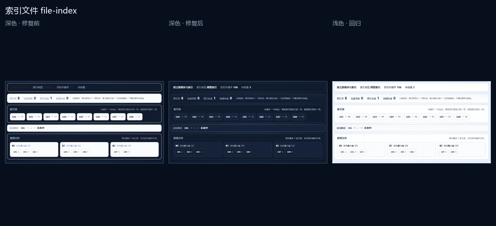 | 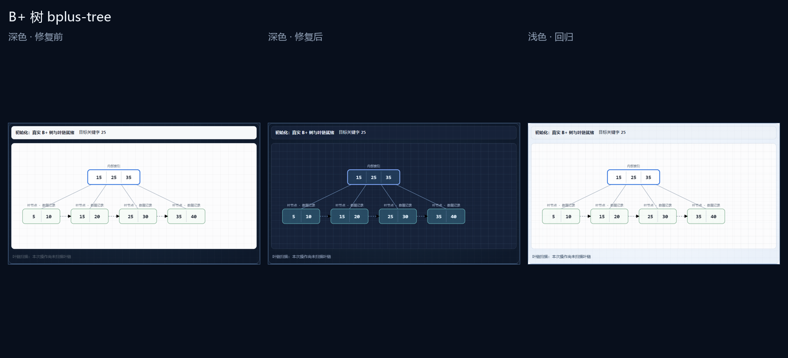 |
| 3 个文件块、路径条、索引项和记录条由白色变为深色面板；文件名、键值和路径文字保持可读。 | 画布从 167,640 px² 的白色区域变为深色网格；节点、叶链、路径高亮和文字同步适配。 |

| 键树 `key-tree` | 倒排索引 `inverted-index` |
| --- | --- |
| 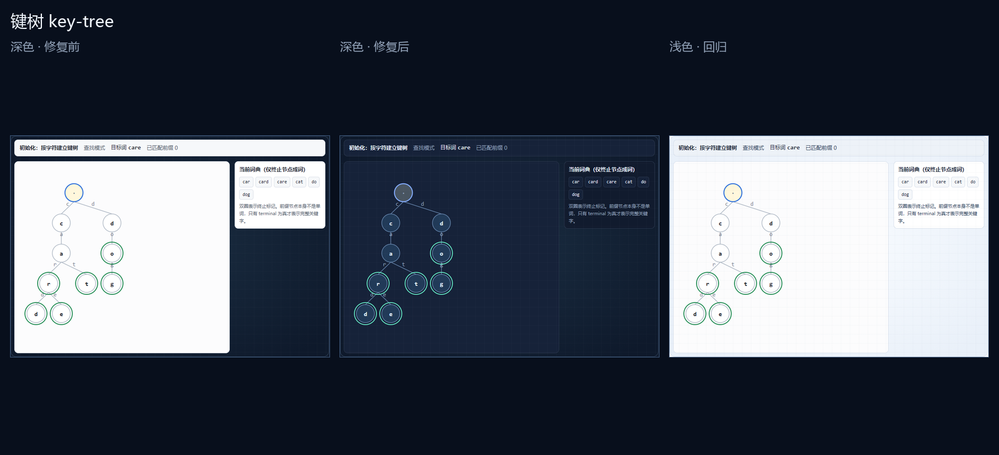 | 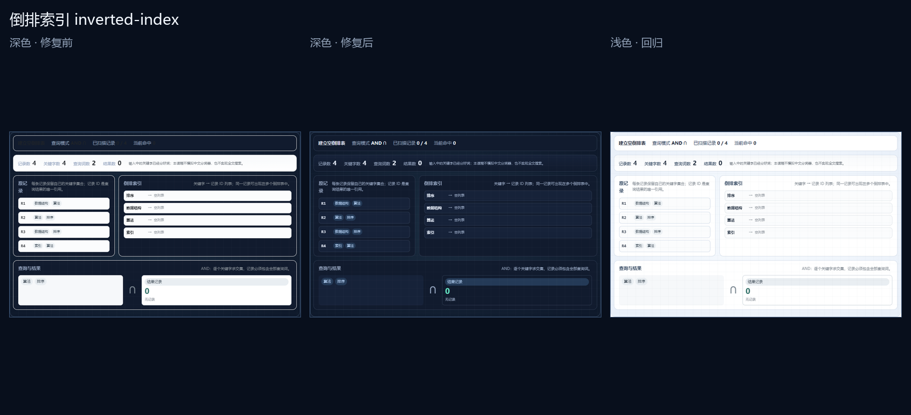 |
| 148,520 px² 的白色画布和 33,570 px² 的白色词典改为深色；9 个节点圆、树枝和命中标签保持独立语义。 | 记录、词条、查询区和结果框的多个白色子表面统一改为深色；AND 查询和结果数量仍清楚。 |

### 7.2 排序与外部排序

| 锦标赛树 `tournament` | 多路归并 `multiway` |
| --- | --- |
| 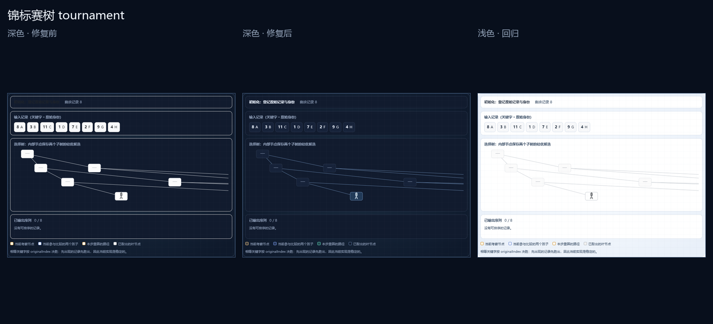 | 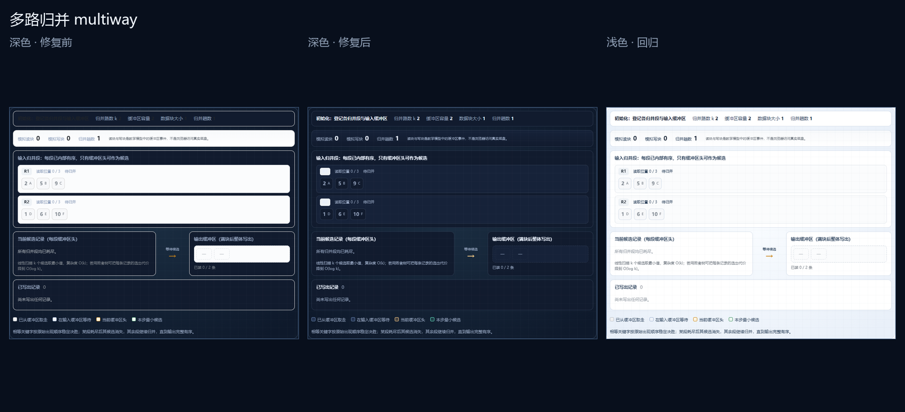 |
| 15 个白色节点矩形改为深色节点；当前、比较、受影响、移出和补位状态仍可区分。 | 2 个归并段和桶的白色区域改为深色面板；冻结、当前、已完成的 chip 和流向箭头保留语义。 |

> `tournament` 另有一个与本轮主题无关的既有布局缺陷：叶层节点的横向间距被排到画布外，导致树只显示左侧部分节点。本轮按“不得修改节点坐标和算法布局”的边界未修复，详见第 11 节。

### 7.3 广义表与数组交互

| 广义表深度 `gl-depth` | 数组选中态 `array-basics` |
| --- | --- |
| 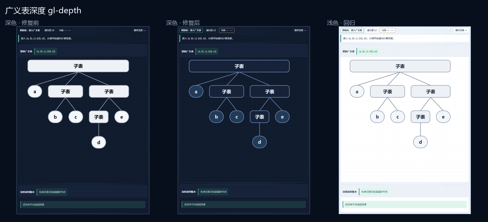 | 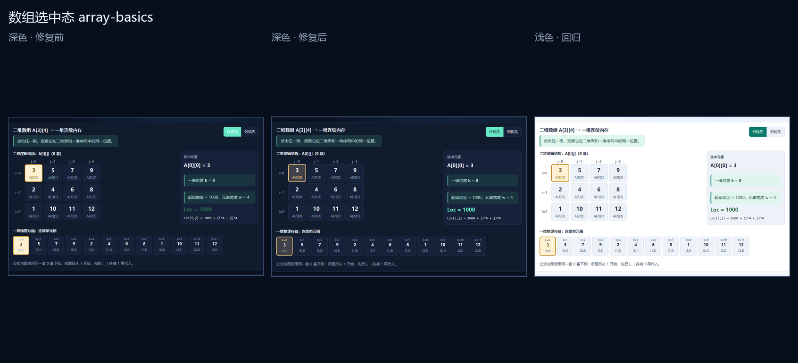 |
| 每页 9 个固定浅色节点改为深色节点；账本、公式、完成横幅和树边在上层深色面板中保持一致。 | 选中格从固定浅黄改为暖色 token 混合；选中索引和地址使用深色主题前景，交互状态不丢失。 |

## 8. 全屏、缩放与主题切换

### 8.1 全屏

`file-index` 在深色全屏工作区中通过同一组组件渲染，没有单独的白色画布副本。验证内容：

- 100% 全屏：图解背景、节点、文字与普通页面一致。
- 200% 放大：节点和图形放大，深色背景不出现白块；文字视觉字号保持既有全屏排版约束。
- 50% 缩小：节点、文字和连线仍可辨认。
- 退出全屏：工作区关闭后页面仍为深色，`file-block` 仍为非白表面。

截图：

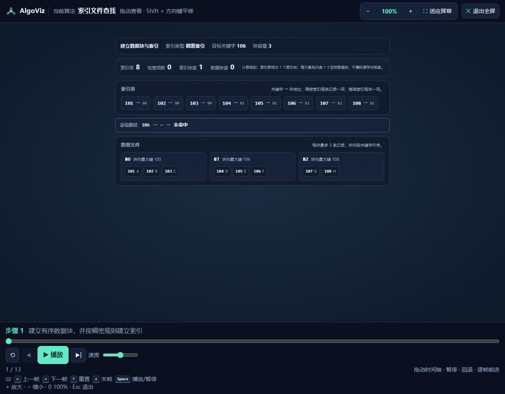

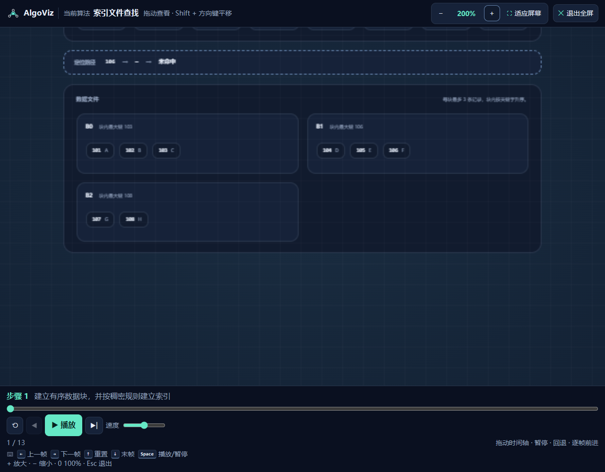

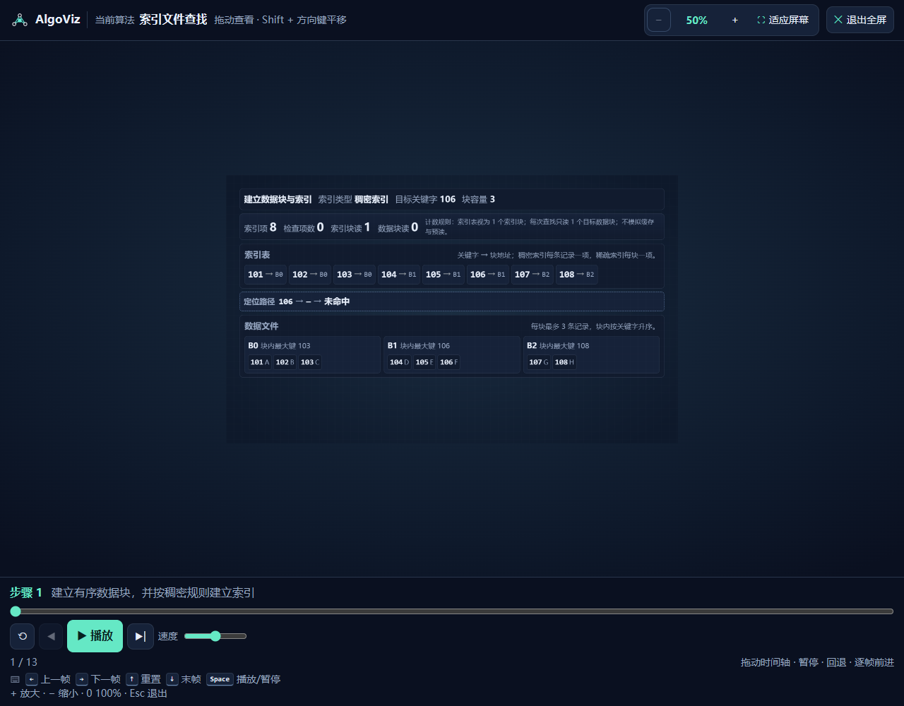

### 8.2 主题切换

`tournament` 第 2 帧在深色 → 浅色 → 深色切换后仍保持 `2 / N`，没有重置算法帧。切换路径只更新根节点的主题属性，不调用 Trace、不重新创建 Pyodide Worker，不关闭全屏工作区，不清空用户输入。

该页同时映出第 11 节所述既有树节点布局缺陷；本图只用于核对主题切换前后的背景、文字和帧号，不用于证明节点的横向排布。

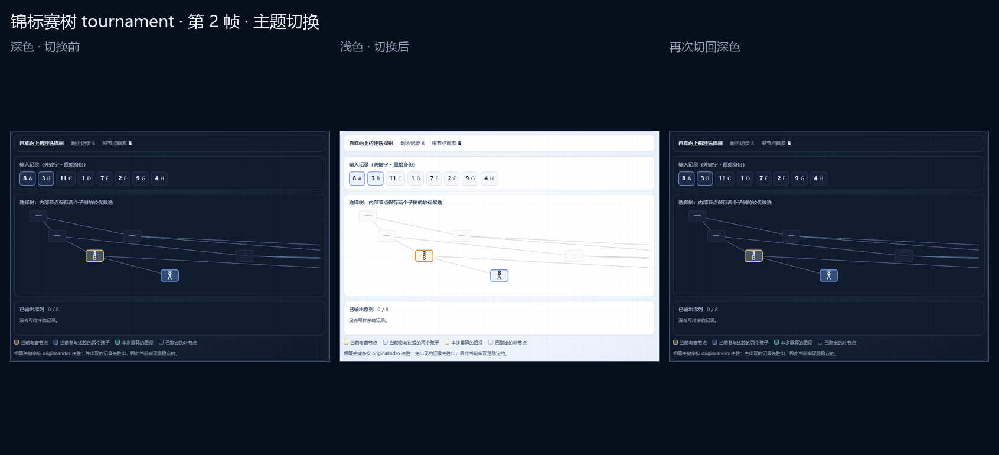

## 9. 视口矩阵

在 `file-index`、`tournament`、`gl-depth` 三页上，分别以浅色和深色检查 360、390、768、1280、1440 px，共 30 个组合。所有组合的页面级横向溢出均为 0 px，深色图解表面均保持非白；完整数值见 `docs/assets/dark-diagram-01/viewport-report.json`。

宽图在窄视口保留组件内部的横向滚动区域，页面外壳不产生横向滚动。需要注意：在 1280 且算法导学展开时，`tournament` 的外层视觉块曾测得宽 746 px、stage 宽 542 px；这是既有容器布局造成的首屏裁切，主题切换前后几何值相同。收起导学后改为组件内滚动。本轮未修改该布局。

| 页面 | 深色 | 浅色 |
| --- | --- | --- |
| `file-index` | 5 / 5 组合通过 | 5 / 5 组合通过 |
| `tournament` | 5 / 5 组合通过（页面溢出 = 0） | 5 / 5 组合通过（页面溢出 = 0） |
| `gl-depth` | 5 / 5 组合通过 | 5 / 5 组合通过 |

## 10. 验证结果

### 10.1 自动审计

| 检查 | 修复前 | 修复后 |
| --- | ---: | ---: |
| 静态专题页帧背景为白色 | 0 / 56 | 0 / 56 |
| 静态专题页 SVG 白色 `fill` | 0 / 56 | 0 / 56 |
| 算法页含白色 SVG `fill` 或 >4,000 px² 白色子表面 | 13 / 60 | 0 / 60 |
| 算法页白色 SVG `fill` | 6 页：B+ 树、键树、锦标赛树、最佳归并树、广义表深度、广义表复制 | 0 / 60 |
| 算法页 >4,000 px² 白色子表面 | 9 页 | 0 / 60 |

修复前命中的 13 个算法页：`file-index`、`isam`、`inverted-index`、`block-search`、`bplus-tree`、`key-tree`、`tournament`、`radix`、`multiway`、`replacement`、`optimal-merge`、`gl-depth`、`gl-copy`。

### 10.2 测试与构建

| 项目 | 结果 |
| --- | --- |
| 专项 Vitest `src/theme/darkDiagramTheme.test.ts` | 5 / 5 通过 |
| 全量 Vitest | 169 个文件 / 1,646 项通过 |
| 专项 Playwright `e2e/dark-diagram-01.spec.ts` | 4 / 4 通过（深色 13 个图族、双主题五档视口、主题切换/全屏、静态专题） |
| 全量 Playwright | 270 / 270 通过（25.4 min） |
| `npm run typecheck` | 通过 |
| `npm run build` | 通过（1,965 modules） |
| 既有全屏文字缩放回归 `fullscreenTextScale.test.ts` | 6 / 6 通过，未改动缩放算法 |

### 10.3 浅色回归

- 浅色截图与基线对比：文件结构、B+ 树、锦标赛树、广义表、数组选中态均保持原有浅色层次。
- 新增深色层只匹配 `:root[data-theme='dark']`；浅色主题没有新增选择器命中。
- 浅色主题仍使用原始章节样式；没有出现反向配色。
- 两种主题下节点状态、图例说明、路径高亮和排序状态含义一致，仅颜色表达随主题变化。

## 11. 遗留项与后续建议

> 2026-11-25 更新：以下最初两条锦标赛树布局问题已由 `LAYOUT-02` 修复。叶层坐标改为按 `2^(height-level)` 分槽，八叶横坐标现在为 62.5–937.5；1280 px 导学展开时 `.tournament-visual` 收进 542 px 的 stage，树图改为组件内横向滚动并提供非遮挡提示。完整证据见 [`LAYOUT_02_TOURNAMENT_TREE.md`](LAYOUT_02_TOURNAMENT_TREE.md)。本节保留原审计记录作为历史基线。

- 本轮未发现残留的深色主题白底或不可读关键文字。13 个曾命中的算法页现在均为 0 个白色 `fill`、0 个大于 4,000 px² 的白色子表面。
- 原审计发现一个与本轮主题无关的既有 `tournament` 布局缺陷：在 1600 px 视口、导学收起状态下，`.sort10-tree` 可视宽 735 px，但 8 个叶节点实际的 `x` 从 655 px 递增到 5,800 px（每级 735 px），大部分节点被画到 SVG 可视区之外。根因指向 `src/domain/visualization/tournamentModel.ts` 的叶层横坐标公式；它属于节点坐标与算法布局，按本轮范围限制未修改。**该问题已在 LAYOUT-02 修复，并补充“所有节点必须落在 SVG viewBox 内”的几何断言。**
- 1280 px 且算法导学展开时，`stage` 对部分宽图存在既有首屏裁切：曾测得 `visual-stage` 宽 542 px、`.tournament-visual` 宽 746 px，且 stage 为 `overflow: hidden`。这是 v1.0.0 已有的容器布局，不是主题层引入；本轮按“不修改算法布局”的边界未调整。导学收起后宽图进入组件内横向滚动，页面本身不横向溢出。**该裁切已在 LAYOUT-02 修复：视觉块不再按 SVG 最小内容宽度撑开，树图有了独立的可聚焦横向滚动层和提示。**
- 原章节 CSS 中仍保留浅色硬编码。这是浅色主题的基线资产，深色层只做覆盖。后续不得仅凭源码中的 `#fff` 判定回归，必须同时通过浏览器截图和计算值检查。
- 本轮没有新增 Tag、Release、分支或 Worktree；后续发布节奏由主项目维护流程决定。

## 12. 复现命令

```powershell
npm run test -- src/theme/darkDiagramTheme.test.ts
npm run test:e2e -- dark-diagram-01.spec.ts
npm run typecheck
npm run build
```

证据图片目录：`docs/assets/dark-diagram-01/`。
