# LAYOUT-02 · 锦标赛树节点越界与窄容器裁切

本轮只修复 `DARK-DIAGRAM-01` 审计遗留的两个锦标赛树布局问题。未重新开展主题审计，未修改算法逻辑、Trace 语义、播放器状态或全屏缩放数学。

## 1. 基线

基线提交：`57298b63dbf1c0bb0f157015f049da7a18c322cd`。

| 项目 | 修复前 |
| --- | --- |
| 模型 `viewBox` | `0 0 1000 276` |
| 八叶节点 SVG `x` | `500, 1500, 2500, 3500, 4500, 5500, 6500, 7500` |
| 叶节点最右边界 | 约 7,529 SVG 单位，超过 1000 宽 viewBox |
| 1600 px 下 `.sort10-tree` | 最小宽度 720 px；实际可视宽约 735 px，L7 屏幕左边界约 5,703 px |
| 1280 px 导学展开 | `visual-stage` 542 px；`.tournament-visual` 746 px、`offsetLeft = -103 px` |
| 1280 px stage 行为 | `overflow: hidden`，宽图左右被静默裁切 |

修复前截图：`assets/dark-diagram-01/compare-tournament.png` 的深色一栏；该图只证明旧坐标缺陷，不用于本轮主题验收。

## 2. 根因

`src/domain/visualization/tournamentModel.ts` 中：

\[
x = (slot + 0.5) \cdot \frac{1000}{2^{level}}
\]

但 `level=0` 是叶层，`level=height` 是根层。倒置的分母使叶层得到 1000 单位的槽距，根层反而得到 125 单位；八叶时 L0、L1、…、L7 被推到 500、1500、…、7500。

正确槽距应由 `height - level` 决定：

\[
x = (slot + 0.5) \cdot \frac{1000}{2^{height-level}}
\]

修复后八叶横坐标为 `62.5, 187.5, …, 937.5`，根节点保持 `500`，每个父节点正好位于两个孩子横坐标的中点。

第二个问题是 CSS 最小内容宽度传导：`.tournament-visual` 和树面板没有把宽度约束在 stage 的可用宽度内，SVG 的 `min-width` 使整个视觉块按 746 px 的最小内容宽度布局，并被 542 px 的 stage 裁掉。仅把 stage 改为 `overflow: auto` 会让页面滚动，不符合要求。

## 3. 修复

- `tournamentModel.ts`：改用 `2^(height - level)` 计算层级槽数，修正叶层间距。
- `Sorting10Visuals.tsx`：
  - `.tournament-visual` 加入 `width: 100%; min-width: 0; max-width: 100%`，阻止最小内容宽度撑破 stage。
  - 将树 SVG 放进 `.sort10-tree-scroll`，只有这一层横向滚动，面板与 stage 不再裁切。
  - 通过 `ResizeObserver` 检测真实 `scrollWidth > clientWidth`，仅在溢出时渲染“可横向滚动”提示；滚动区可聚焦并关联 `aria-describedby`。
  - 暴露 `data-leaf-count`、`data-node-count`、`data-view-width`、`data-view-height`、`data-tree-overflows`，供几何与响应式测试使用。
- `sorting10.css`：
  - `.sort10-tree` 最小宽度调整为 700 px，1600 px 下完整树可一次显示。
  - 滚动区使用细滚动条、`overscroll-behavior-x: contain`、键盘焦点轮廓；提示位于树下方，不覆盖图形。
- `messages.ts`：增加中英文滚动提示文案。

未修改 `.visual-stage` 的全局规则，也未用调整 stage 高度、隐藏节点、缩小字号或删除节点来掩盖问题。

## 4. 修复后几何

| 视口 / 状态 | `.visual-stage` | `.tournament-visual` | 树滚动区 | 结果 |
| --- | --- | --- | --- | --- |
| 1600 / 导学展开 | 762.5 px | 728.5 px | 703 / 703 px | 无滚动，8 叶全可见 |
| 1280 / 导学展开 | 542 px | 508 px | 700 / 484 px | 组件内滚动，提示显示 |
| 1280 / 导学收起 | 542 px | 508 px | 700 / 484 px | stage 与页面均无外溢 |
| 768 / 导学展开 | 688 px | 654 px | 700 / 628 px | 组件内滚动，提示显示 |
| 390 / 移动端 | 330 px | 308 px | 700 / 274 px | 组件内滚动，提示显示 |

所有五档布局均满足：

- 8 个叶节点、15 个总节点，父子关系正确。
- 每个节点矩形完全落在 `0 0 1000 276` 的 viewBox 内；最左叶矩形左边界 2.25，最右叶矩形右边界 997.75。
- 窄容器下最后一个叶节点可通过横向滚动进入滚动区可视范围。
- 页面级横向溢出为 0；stage 的 `scrollWidth` 不超过 `clientWidth`。

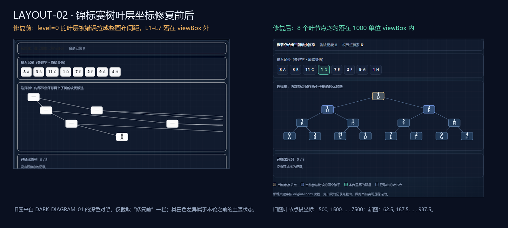

## 5. 视口与主题截图

### 1600 px

首帧为未填充树骨架，后续 `select` 帧为完整八叶树；两者共用同一套坐标。

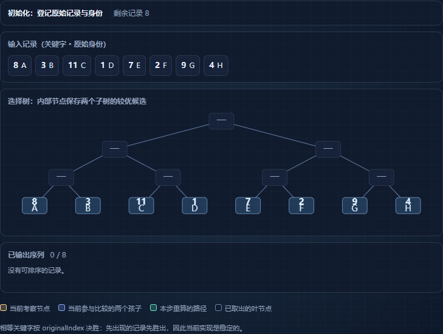

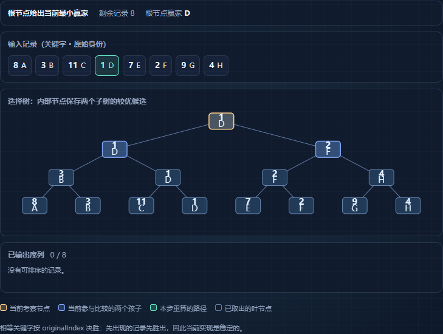

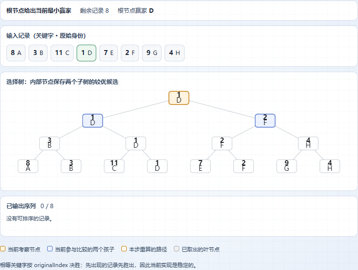

### 1280 px，导学展开

左侧为初始滚动位置，右侧为滚到最右端后 L7 可见；提示固定在树图下方，不遮挡节点。

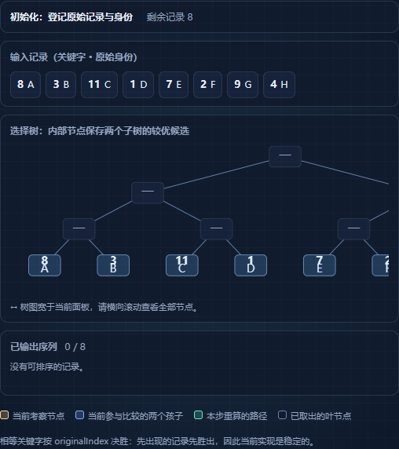

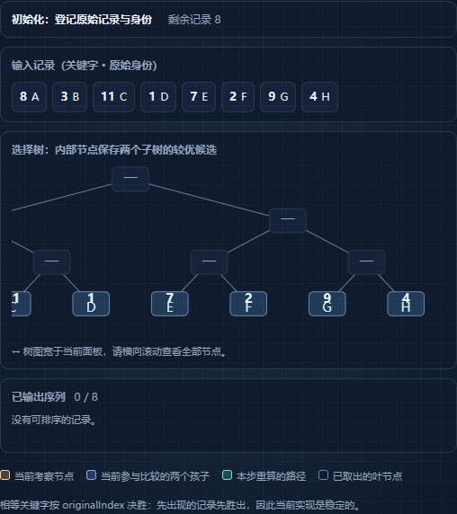

### 1280 px，导学收起

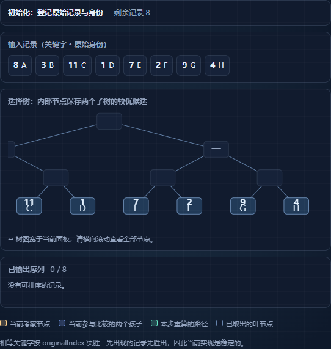

### 390 px

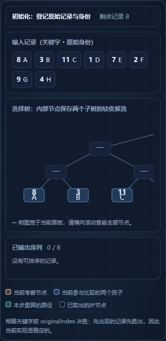

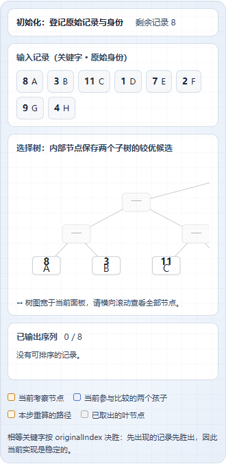

### 768 px

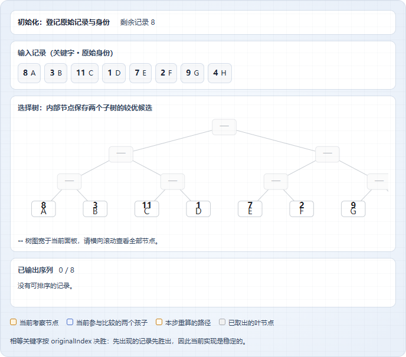

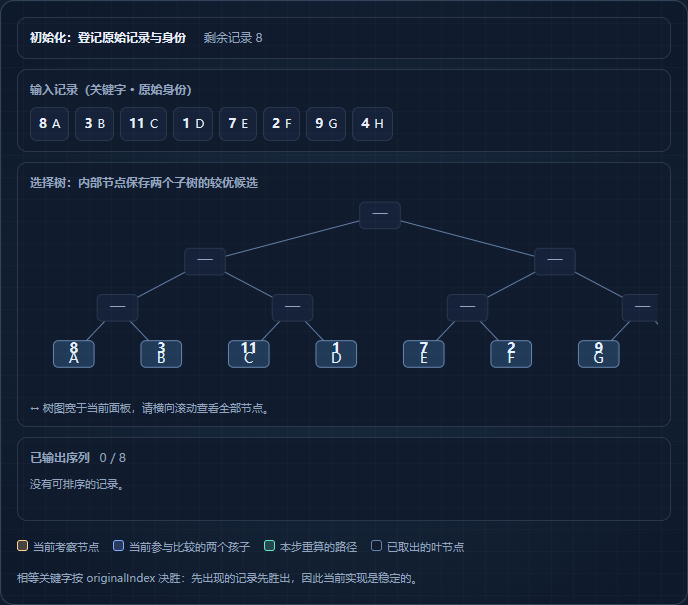

## 6. 全屏与缩放

- 全屏 100%：完整树、图例、播放器均可见，主题保持深色。
- 全屏 200%：图形按既有缩放规则放大，超出部分通过拖动/Shift+方向键平移；未新增裁切规则。
- 全屏 50%：完整树仍在工作区中，缩放值显示正确。
- 适应屏幕与退出全屏后，普通页面的锦标赛树仍正常；未修改全屏缩放数学或文字字号锁定逻辑。

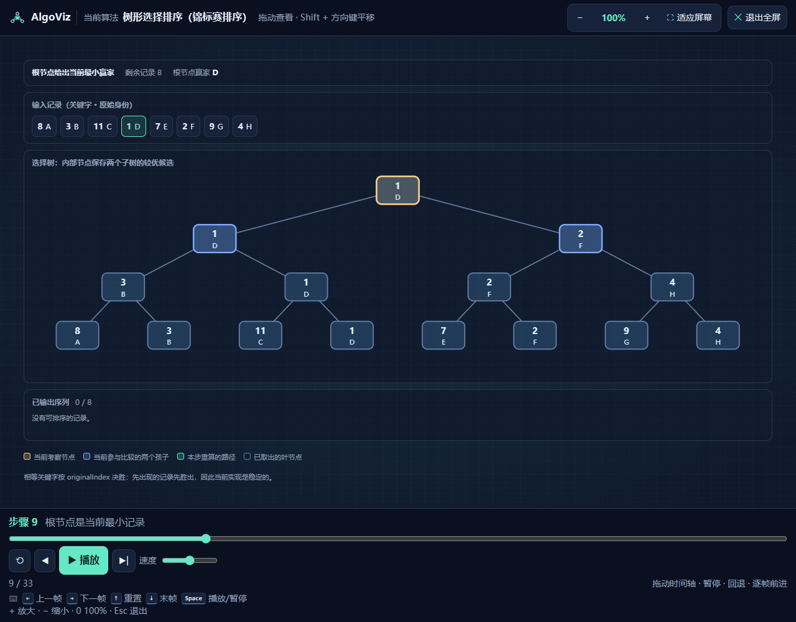

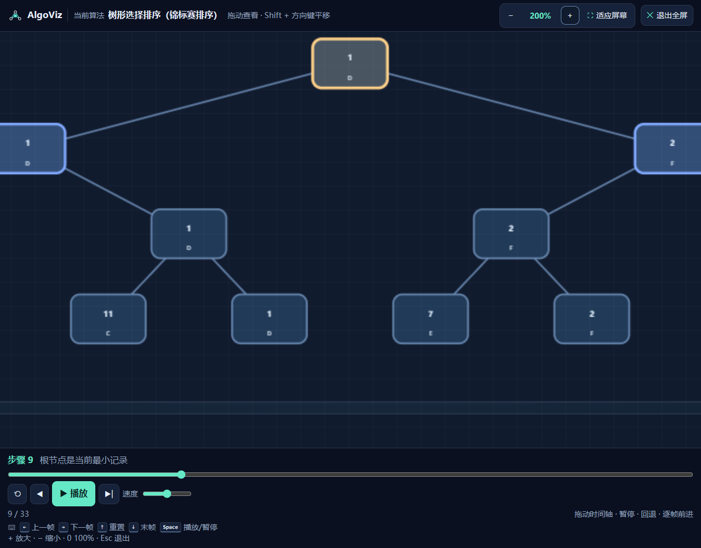

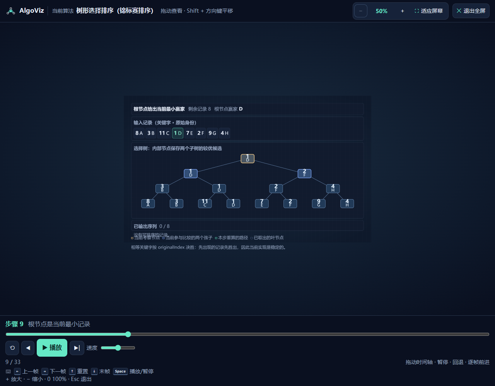

## 7. 测试

- `src/domain/visualization/tournamentModel.test.ts`：4/4 通过。
  - 所有真实 Trace 帧的节点在 viewBox 内。
  - 父节点位于两个孩子中点，父子层级关系正确。
  - 八叶坐标精确为 `62.5, …, 937.5`，根节点为 `500`。
  - 最大合法 16 叶树不越界；单叶树居中。
- `e2e/layout02.spec.ts`：5/5 通过。
  - 1600 px 深/浅主题、首帧与完整树。
  - 1280 px 导学展开、内部滚动、滚动提示、最后叶可达、导学收起。
  - 390 px 深/浅主题。
  - 768 px 深/浅主题。
  - 全屏 100/200/50、帧号保持、退出全屏。
- 专项 Playwright 总耗时 16.2 s；专项 Vitest 134 ms。
- 全量 Vitest：170 个文件、1,650 项全部通过（31.99 s）。
- 全量 Playwright：275/275 通过（25.8 min），包含本轮新增的 5 项。
- `npm run typecheck` 通过（14.99 s）；`npm run build` 通过（1,965 modules，Vite 29.23 s）。
- GitHub Actions：CI run `45635487769` 成功；Pages run `45635487832` 成功（Build 2m36s、Deploy 12s）。
- 部署后公网 `?view=lab` 冒烟 25 项通过：390 移动端、1600 宽屏、1280 导学展开、L7 内滚可达、深浅主题、全屏 200%。
- 已知既有测试时序风险：`ReferenceCodePanel.test.tsx` 的动态加载断言偶发 1 s 超时；本轮未修改该测试或放宽超时，单跑、限并发全量和最终默认全量均通过。

## 8. 影响范围与限制

- 只影响锦标赛树：`tournament-visual`、`sort10-tree-panel`、`sort10-tree-scroll`、`sort10-tree` 均是锦标赛专属选择器；没有修改共享的 `visual-stage`、`fullscreen-world`、SVG 文本缩放 hook 或其他算法模型。
- 窄容器下保留组件内横向滚动是设计选择，不是裁切：700 px 最小宽度保证节点文字仍可辨认；宽屏 1600 px 无需滚动。
- 最大合法 16 叶树同样位于 1000 单位 viewBox 内；更密集的自定义输入不属于当前 `TOURNAMENT_MAX_LEAVES` 契约。
- 本轮未重新检查或改动主题配色；截图只用于证明布局修复没有破坏既有深色表面。
