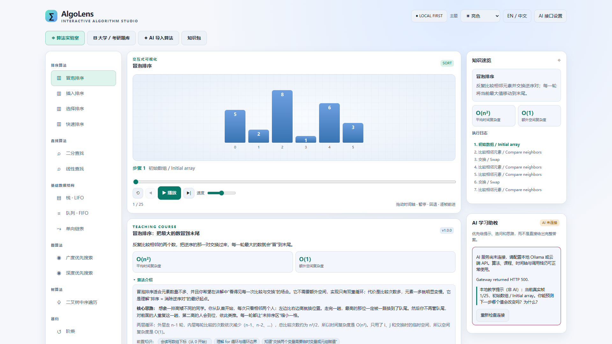
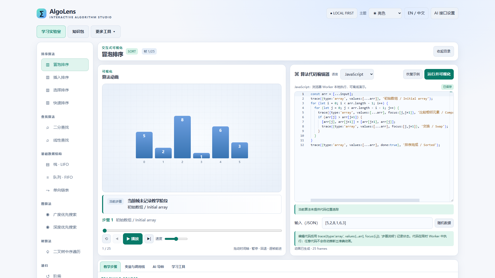
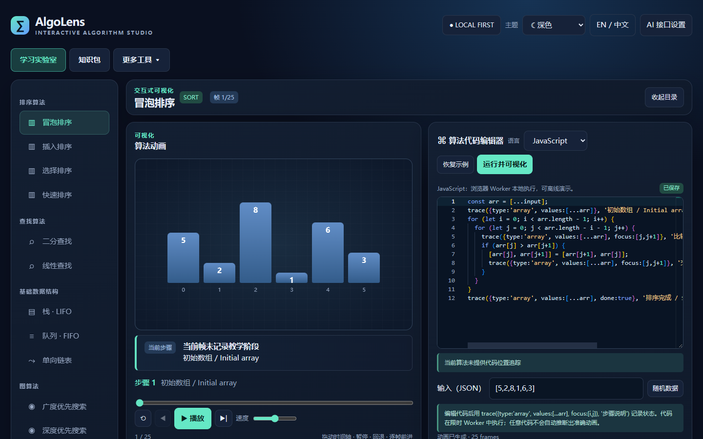
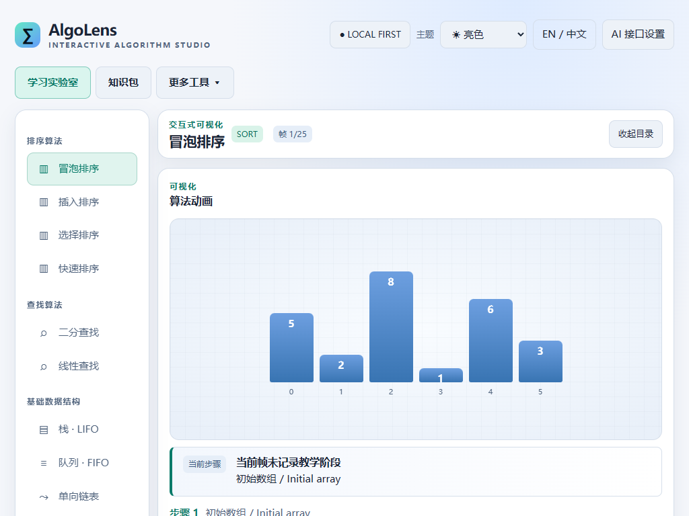
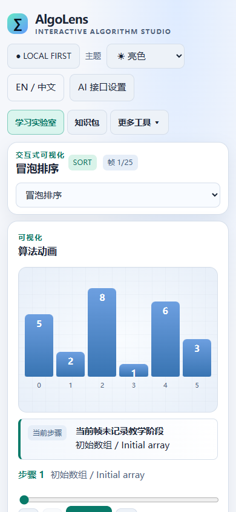
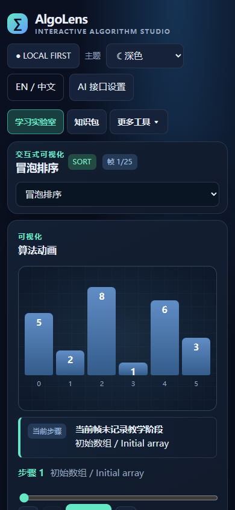
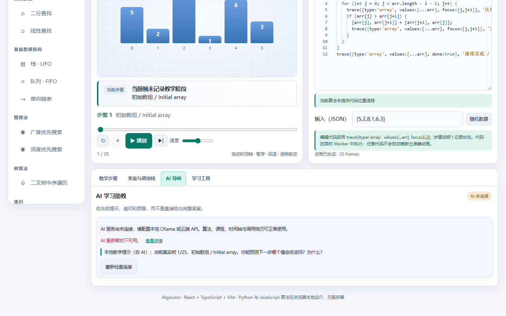

# STAGE 7A · 学习实验室 UX/UI 重构报告

- 日期：2026-11-16
- 基线：`6617e0d`（Stage 6A 收尾）
- 分支：`main`
- 远端：`https://gitee.com/vvvi734/algolens.git`
- 版本：`0.8.0-phase7a`
- 阶段边界：只做学习实验室的信息架构、布局、可读性、响应式与必要的状态/交互修复；不新增算法、不改执行引擎、不实现数据结构专属动画（Stage 7B）。

## A. 改版前的问题清单

改版前证据来自真实页面：`docs/stage7a/before/` 与 `docs/stage7a/before/metrics.json`（脚本 `scripts/capture-ui.mjs`，Playwright + 本机 Edge + `http://127.0.0.1:4173`）。

| 基线视口 | 页面高度 | 横向溢出 | 旧主区列宽 | 直接后果 |
| --- | ---: | --- | --- | --- |
| 1920×1080 | 3089 px | 无 | `240px / 1049px / 315px` | 主动画只有约一半宽，整页需要长滚动 |
| 1440×900 | 3129 px | 无 | `240px / 809px / 315px` | 右栏挤占，Monaco 远在动画下方 |
| 1024×768 | 3601 px | 无 | `190px / 774px`（右栏沉底） | 三列硬挤/折行，典型拥挤场景 |
| 768×1024 | 3893 px | 无 | — | 目录、动画、代码、课程纵向堆叠 |
| 390×844 | 5316 px | **有**：`scrollWidth=718 / clientWidth=390` | — | 整体横向滚动，手机不可正常阅读 |

逐项问题（与用户截图对应）：

1. **三块并排抢占宽度**：目录 + 动画 + 知识/AI 右栏固定存在，动画和代码都不宽裕。
2. **代码区离动画太远**：可编辑 Monaco 位于动画和同步观察之后，1920 下首屏看不到，用户必须上下滚动才能对照。
3. **两份完整代码**：`SyncPanel` 渲染整份只读源码，Monaco 又渲染可编辑源码，信息重复且浪费高度。
4. **课程一次性全展开**：算法介绍、前置知识、复杂度、全部步骤、常见错误同时铺开，形成长文字卡片墙。
5. **字号过小/文字偏浅**：大量 10–11 px 的 eyebrow、标签和说明，正文与次级说明层级不清。
6. **AI 未连接错误权重过高**：Gateway 返回 HTTP 500 时直接显示原始错误文本，红色错误卡比学习内容更抢眼。
7. **Agent 会话永久占位**：导入/导出、知识包、AI 设置等低频工具长期占据主工作区。
8. **主导航噪声**：题库、AI 导入算法与学习实验室并列，主线不突出。
9. **1024 布局没有降级**：仍按桌面三列处理，形成窄而长的卡片流。
10. **手机横向溢出**：390 px 下页面宽 718 px，代码/表格/课程把页面撑破。
11. **首屏任务路径不完整**：用户看不到“选择算法 → 看动画 → 看代码 → 运行/单步 → 理解当前步骤”的连续路径。

## B. 新信息架构

```text
┌──────────────────────────────────────────────────────────────┐
│ AlgoLens   学习实验室   知识包   更多工具        主题/语言/设置 │
├──────────┬──────────────────────────┬────────────────────────┤
│ 算法目录 │ 算法动画                  │ Monaco Python 代码      │
│ (可折叠) │                          │ 当前执行行高亮          │
│          │ 当前步骤（阶段/说明/变量） │ 运行 / 恢复 / 输入      │
│          │ 时间轴与播放控制          │                        │
├──────────┴──────────────────────────┴────────────────────────┤
│ 教学步骤 │ 变量与调用栈 │ AI 导师 │ 学习工具（按需显示一个）     │
└──────────────────────────────────────────────────────────────┘
```

- **一级（始终在场）**：动画、当前步骤、时间轴、Monaco。当前步骤放在动画与时间轴之间，1440×900 首屏完整可见。
- **二级（按需标签）**：教学步骤（compact 课程 + 当前阶段）、变量与调用栈、完整讲义/常见错误。
- **三级（按需标签/菜单）**：AI 导师、Agent 会话导入导出、知识包入口、AI 设置、题库（暂停）与 AI 导入（实验）。
- **导航**：只保留「学习实验室 / 知识包 / 更多工具」；题库与 AI 导入在 `nav-more-menu` 内，原有页面、数据和兼容逻辑未删除。
- **代码唯一主面**：Monaco 是唯一可编辑代码区；`SyncPanel` 的只读源码改为「查看已执行源码快照」，需要时展开，不默认重复。

## C. 修改文件清单

新增：

| 文件 | 作用 |
| --- | --- |
| `src/features/lab/WorkspaceTabs.tsx` | ARIA tablist + 四个常驻 `hidden` 面板 + 左右方向键焦点切换 |
| `src/features/lab/WorkspaceTabs.test.tsx` | 3 项：面板常驻、隐藏状态保留、键盘切换焦点 |
| `src/styles/stage7a.css` | 全部新布局、字号、响应式、reduced-motion；颜色只引用 token |
| `e2e/stage7a.spec.ts` | 6 条 Stage 7A 浏览器 E2E |
| `scripts/capture-ui.mjs` | 五视口 × Light/Dark 截图与布局指标（含 AI 面板、全页图） |
| `docs/stage7a/before/`、`docs/stage7a/after/` | 改版前后真实截图与 `metrics.json` |
| `docs/STAGE7A_REPORT.md` | 本报告 |

主要修改：

| 文件 | 变更 |
| --- | --- |
| `src/features/lab/LabView.tsx` | 重写信息架构；`.lab-shell`/`.lab-primary`；当前步骤移入动画面板；`WorkspaceTabs`；目录折叠与移动端算法选择 |
| `src/features/lab/Timeline.tsx` | 播放区包成 `.stage-playback`，使当前步骤稳定位于动画与时间轴之间 |
| `src/features/lab/LessonPanel.tsx` | 新增 `compact`：标题、一句话、复杂度、步骤 chip、当前阶段；完整讲义折叠；保留全部 testid |
| `src/features/lab/SyncPanel.tsx` | 新增 `showSource`/快照开关；变量、调用栈、解释仍随 `currentEvent` |
| `src/features/lab/AiMentor.tsx` | 友好错误标题 +「查看详情」；原始错误仍保留在 `mentor-error-detail-body` |
| `src/features/lab/CodeEditorPanel.tsx` | 增加布局 class，不改 Monaco 模型/高亮/诊断 |
| `src/components/NavTabs.tsx` | 导航收敛 + 更多工具菜单（Escape/外点关闭） |
| `src/app/App.tsx` | 传入 `onOpenApi`，菜单中的 AI 设置可用 |
| `src/i18n/messages.ts` | 新增 Stage 7A 中英 key（tab、当前步骤、目录、快照、更多工具、AI 错误等） |
| `src/main.tsx` | import `stage7a.css` |
| `src/theme/tokens.test.ts` | 将 `stage7a.css` 纳入无硬编码颜色扫描 |
| `src/app/App.dom.test.tsx` | 按新导航通过「更多工具」进入题库/AI 导入，不降低断言 |
| `src/app/App.stage3.playback.test.tsx` | 源码快照改为按需展开后，先开「变量与调用栈」再开快照；仍断言真实 active 行号 |
| `e2e/lab.spec.ts`、`mentor.spec.ts`、`packs.spec.ts`、`session.spec.ts` | 适配标签页导航与显式打开面板；业务流程断言不变 |
| `README.md`、`docs/ARCHITECTURE.md` | Stage 7A 架构、入口与测试数量 |
| `package.json` / `package-lock.json` | `0.8.0-phase7a` |

未删除：`ConceptPanel` 组件与测试仍在，只是不再常驻学习视图；题库、AI 导入、会话协议、知识包、MCP、AI Gateway 均未删除或改写协议。

## D. 状态管理与生命周期

- **唯一执行状态仍在 `useLabController`**：`events`、`playback.index`、`currentEvent`、`runId`、`traceStale`、Monaco 草稿、诊断都不进入标签组件。`LabView` 只读控制器。
- **标签不卸载**：`WorkspaceTabs` 同时渲染 `workspace-panel-lesson/state/mentor/tools`，通过 `hidden` 与 `aria-selected` 切换。Monaco、时间轴、Trace、AiMentor、SessionPanel 都不会因切标签重建。
- **单测证明隐藏状态保留**：`WorkspaceTabs.test.tsx` 在 state 面板输入草稿，切到 mentor 再切回，输入值仍在。
- **E2E 证明真实 Monaco 不丢**：`stage7a.spec.ts` B 修改 Monaco 文本，依次切 AI/变量/教学，文本保留；运行进度和 `run-feedback` 文本不变；`.algolens-active-line` 仍为 0（未自动执行）。
- **切标签不自动运行、不重置时间轴**：没有新增 effect 调用 `runVisualization` 或 `playback.restart`；播放仍由 `usePlayback` 边界控制。
- **请求隔离沿用 Stage 6A**：AI 请求仍由 requestId + 快照元数据绑定；切换帧会 abort 在途请求，旧回答不会冒充新步骤。
- **当前步骤只读真实帧**：`activeStep` 由 `lessonStepIdOf`/`stepIndexForEvent` 从当前 `currentEvent` 计算，不使用第二套索引。

## E. 响应式设计

| 视口 | 策略 | 实测 |
| --- | --- | --- |
| ≥ 1280 | 目录 220 px；动画 + Monaco 两列；当前步骤在动画下、时间轴前；标签全宽 | 1920：列 `732 / 654`，当前步骤 `y=757`；1440：列 `605 / 541`，当前步骤 `y=687`，完整落在 900 高首屏 |
| 1024（≤1279） | 目录 200 px；主区单列：动画 → 当前步骤 → 代码 → 标签；`.lab-primary{display:contents}` 只改顺序 | 主区 732 px，动画 330 px，当前步骤 `y=665`（在 768 高首屏内），代码随后；`bodyHeight 2225`，无横向溢出 |
| 768×1024 | 同上单列；目录仍在 | 动画 688×330，当前步骤 `y=721..794`，无横向溢出，`bodyHeight 2340` |
| ≤ 899 | 静态目录隐藏，改顶部 `mobile-algo-select`；折叠按钮隐藏 | 算法可切换，页面无溢出 |
| ≤ 760（390） | 单列；app padding 12；课程 steps 纵向内部滚动；头部控件全宽 | 390×844：`scrollWidth=390 == clientWidth`，动画 330×240，当前步骤 `690..758` 完整可见，`bodyHeight 2600`（旧 5316） |

旧手机横向溢出 `718 > 390` 已消失；五个视口 `overflowX=false`。

## F. 视觉与可读性

- **字号**：正文 15 px；次级说明 ≥13 px；标签 12 px；代码 13 px；标题 21/19 px（桌面/手机）。没有为了塞内容继续缩小正文。
- **颜色**：`stage7a.css` 只使用 `tokens.css` 变量；`tokens.test.ts` 扫描硬编码颜色并通过。Light/Dark/System 三态不变。
- **对比度抽检**（相对 panel/white 背景，WCAG 公式）：

| 令牌 | Light | Dark |
| --- | ---: | ---: |
| 正文 `--txt` | 15.46:1 | 14.89:1 |
| 次级 `--muted` | 5.96:1 | 6.82:1 |
| 强调 `--accent` | 5.25:1 | 11.39:1 |
| 错误 `--red` | 6.14:1 | 7.84:1 |

均超过 AA 4.5:1（仅代表这些关键令牌的抽检，不是全站自动化结论）。

- **不只靠颜色**：当前步骤有「当前步骤」文字标签、阶段标题和说明；帧状态显示「帧 N / M」文字；错误有「AI 服务暂时不可用」标题与详情按钮。
- **卡片层级**：动画/代码为一级面板；当前步骤为内嵌强调条；标签内容只有一个面板可见，减少多层嵌套卡片。课程正文用标题、段落、列表与留白，不再把长文塞进一个密集框。
- **交互**：运行按钮为 primary；禁用按钮降透明度并有 `disabled`；时间轴原生 range 可拖；所有弹窗/菜单有 Esc/关闭；全局 `:focus-visible` 2 px outline；`prefers-reduced-motion` 已有降级。
- **AI 错误**：HTTP 500 显示「AI 服务暂时不可用 + 查看详情」，原始错误仍在折叠区；不再用整块红色错误卡压过学习内容。
- **未使用装饰性渐变/阴影掩盖阅读问题**；只保留既有轻量背景和当前步骤的浅色强调。

## G. 前后截图（真实运行页面）

改版前（1920 Light，完整页面 3089 px）：



改版后：

**1920 Light**（`bodyHeight 1639`，动画 + 代码 + 当前步骤同屏）



**1440 Dark**（当前步骤 687–760，完整落在 900 高首屏）



**1024 Light**（单列，动画后立即当前步骤，代码随后）



**390 Light**（无页面横向溢出，当前步骤完整可见）



**390 Dark**



**AI 导师标签（1440，Gateway 未连接）**



完整证据：`docs/stage7a/before/`、`docs/stage7a/after/`（1920/1440/1024/768/390 × Light/Dark，含 `*-full.png` 全页图与 `metrics.json`）。截图由 `scripts/capture-ui.mjs` 对实际 `dist/` 构建生成，不是设计稿。

## H. 测试结果

| 门禁 | 命令 | 结果 |
| --- | --- | --- |
| TypeScript | `npm run typecheck` | 通过，0 错误 |
| 单元/组件 | `npm test` | **47 文件 / 381 tests 通过**（基线 378 + 3 个 `WorkspaceTabs`） |
| 构建 | `npm run build` | 通过（`tsc -b && vite build`，dist 已更新） |
| 浏览器 E2E | `npx playwright test --reporter=line` | **22 / 22 通过**（16 条基线 + 6 条 Stage 7A） |
| MCP 协议回归 | 包含于 `npm test` | `packages/mcp-server/src/server.test.ts` **20 / 20** |
| MCP 类型检查 | `npm run mcp:typecheck` | 通过 |
| AI Gateway 回归 | 包含于 `npm test` | providers 10 + server 16 通过；`npm run ai:typecheck` 通过 |
| 真实 Ollama / 云端模型 | — | **未实测**（本机无 Ollama、未配置云端 Key；与 Stage 6A 相同，不宣称完成） |
| 可访问性自动化 | — | **未安装 axe-core，未做自动扫描**；仅完成键盘 E2E（Tab/方向键/Escape）与人工截图审查 |

Stage 7A E2E 覆盖：

1. 1440：动画与 Monaco 并排，当前步骤在动画下且完整落在 900 高首屏。
2. 标签切换：Monaco 草稿保留、进度/反馈不变、无 active 行（不自动运行）。
3. 1024：单列顺序为动画 → 当前步骤 → 代码，页面无横向溢出。
4. 390：算法选择菜单可用、当前步骤可达、无页面横向溢出。
5. 键盘：方向键切标签、Escape 关闭「更多工具」菜单。
6. AI 离线：错误克制、详情可展开、不遮挡实验室。

人工截图检查：1920/1440/1024/768/390 × Light/Dark；无页面级横向滚动；未发现文字截断到不可理解；390 代码仅在 Monaco 内部横向滚动；AI 标签不遮挡运行/时间轴；目录可折叠/手机可切换；深浅主题无低对比正文。

## I. 已知问题

1. **1024×768 无法同时看到代码**：动画 + 当前步骤已在首屏，Monaco 位于当前步骤之后，需要一次滚动。这是单列 + 可读高度的取舍，不是横向挤压。
2. **390 的代码编辑体验**：Monaco 在 328 px 内可用，但长行在编辑器内部横向滚动；页面本身不溢出。
3. **页面仍不是“一屏完成全部”**：1440 `bodyHeight 1569`、1024 `2225`；减少的是无效重复和长卡片流，不是把课程全文压进首屏。
4. **AI 以标签页承载**，不是桌面可拖拽侧栏/移动端全屏抽屉；满足“按需”要求，但未实现可调整宽度面板。
5. **跨步骤 AI 历史**仍沿用 Stage 6A 行为：切换帧会清空当前对话（既有单测依赖）；同一步内切标签会保留。
6. **ConceptPanel 不常驻**：组件、测试和数据仍在，但学习视图不再显示；若未来需要“概念卡”入口，需要另设入口。
7. **未做 axe-core 自动可访问性检测**；触控目标尺寸未逐项审计（主要按钮已放大，但非全部 44×44）。
8. **控制台存在 Monaco 语言服务提示**：`Missing requestHandler or method: getSyntacticDiagnostics / provideInlayHints / ...` 在截图时记录为 `pageerror`；来自现有 Monaco worker 配置，不影响编辑、运行、Trace 与布局，本阶段未修改 Monaco 打包/worker。
9. **真实模型仍未验证**：Ollama/云端/Level 5 真实生成没有在本机跑过；E2E 使用受控 Mock Provider。

## J. Git

- 分支：`main`
- 远端：`https://gitee.com/vvvi734/algolens.git`
- Stage 7A 实现提交：`8d4b1c3`（`feat(stage7a): refactor learning lab workspace UX`，含代码、文档与截图）
- 工作区：提交前有本阶段新增/修改；提交后应为 clean（构建产物 `dist/` 按仓库规则忽略）
- 推送：提交后正常 `git push origin main`；最终哈希与推送状态见交付回复/`git log -1`

## K. 下一阶段建议（只评估，不实现）

1. **栈的桶状可视化**：在现有 `VisualStage` 容器内做“压入/弹出”块，继续保持 `VisualModel` 与 Trace 绑定；需先定义栈状态在 Trace 中的最小 schema 扩展，不能另造执行状态。
2. **队列排队动画**：入队/出队位置与队首高亮；适合用 CSS/SVG 过渡，需控制帧率与 reduced-motion。
3. **链表节点与指针重连**：需要在现有 Trace Event 上增加节点/指针语义或使用可视化适配层；风险高于栈/队列，应先做只读动画。
4. **二叉树与图**：现有树中序/BFS/DFS 已有基础渲染；专属“访问路径/层级”高亮应先统一图布局与节点 id 映射，再评估交互，不宜直接重写渲染器。

范围提醒：这些都属于 Stage 7B，本阶段未新增任何专属动画、未改 Trace Schema v1、未改 Python Worker。完成 Stage 7A 后停止。
