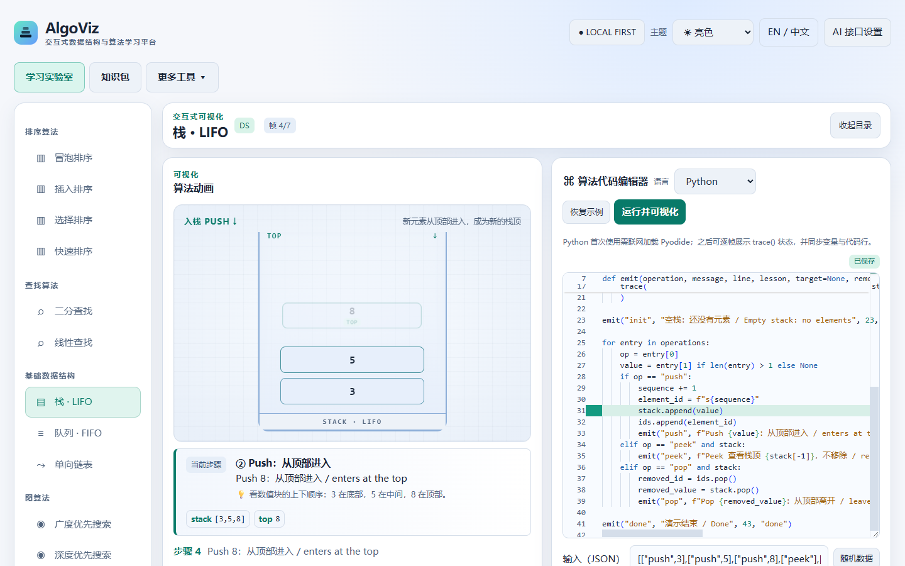
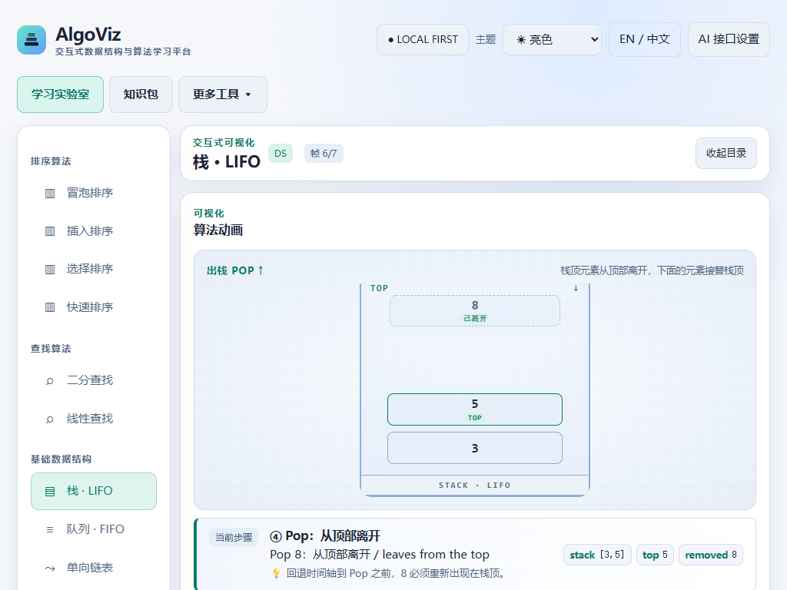
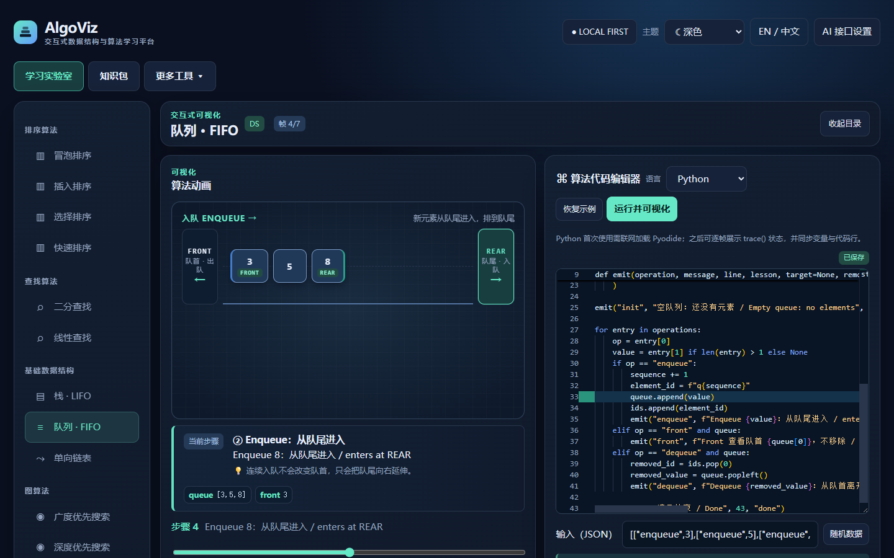
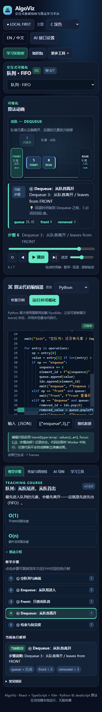

# AlgoViz Stage 7B 阶段报告：品牌迁移 + 栈/队列专属可视化

- 报告日期：2026-11-16
- 版本：`0.9.0-phase7b`
- 分支：`main`
- 远端：`https://gitee.com/vvvi734/algolens.git`（未修改）
- 功能与文档提交：`3f02f8b`

---

## A. 功能完成矩阵

| # | 验收要求 | 状态 | 证据 |
| --- | --- | --- | --- |
| 1 | 用户可见品牌已更名 AlgoViz | ✅ | `index.html`、`TopBar`、footer、README、ARCHITECTURE；E2E 断言标题与 `brand-name` 为 AlgoViz，`body.innerText` 不含 AlgoLens |
| 2 | 旧数据 / 知识包 / 会话格式兼容 | ✅ | 旧 `algolens-*` localStorage 读取测试；IndexedDB `algolens-packs` 未改；`.algopack`、`.algosession.json`、`.algocontext.json` 协议未改；既有 E2E 全绿 |
| 3 | Git remote 未被擅自修改 | ✅ | 仍为 `gitee.com/vvvi734/algolens.git`；未强推、未重写历史 |
| 4 | 栈为 LIFO 的竖直桶状可视化 | ✅ | `StackVisual` 顶部开放、左右/底边框封闭，DOM 按 top→bottom；E2E 断言 `['8','5','3']` |
| 5 | 队列为 FIFO 的横向排队可视化 | ✅ | `QueueVisual` 左 FRONT、右 REAR，DOM 按 front→rear；E2E 断言 `['3','5','8']` |
| 6 | Push / Pop 视觉方向正确 | ✅ | Push `↓` 从顶部进入；Pop `↑` 从顶部离开；`stack-leaving` 单独显示被移除元素 |
| 7 | Enqueue / Dequeue 方向正确 | ✅ | Enqueue `→` 从右侧队尾进入；Dequeue `←` 从左队首离开；剩余元素立即补位 |
| 8 | 使用真实 Python 执行状态驱动 | ✅ | Pyodide 执行 `STACK_PYTHON` / `QUEUE_PYTHON`，每帧 `trace(structure=...)`；E2E 使用真实 7 帧 |
| 9 | 不依赖 message 猜操作 | ✅ | 操作只来自 `event.structure.operation`；组件与模型层无 message 文本解析 |
| 10 | 时间轴回退 / 跳转正确 | ✅ | E2E Pop 后回退恢复 8、Dequeue 后回退恢复 3；任意帧直接渲染快照 |
| 11 | Monaco 当前行高亮正确 | ✅ | Stack E2E 断言 `.algolens-active-line` 可见；真实 `sourceLocation.line` 为 23/31/35/38/43 |
| 12 | 变量观察器正确 | ✅ | `stack [3,5]` + `top 5` + `removed 8`；`queue [5,8]` + `front 5` + `removed 3` |
| 13 | LessonPanel 与操作步骤同步 | ✅ | `lessonStepId` 与 Python `lesson_step=` 完全一致；E2E 断言 `step-desc` 与当前步骤 |
| 14 | 中英文课程完整 | ✅ | 栈/队列各 5 阶段，`zh`/`en` 双语文案与复杂度、常见错误齐备 |
| 15 | 三态主题可用 | ✅ | Light / Dark 截图；System 主题沿用既有机制与测试 |
| 16 | 响应式布局正常 | ✅ | 1440 / 1024 / 390 实测；1024 无三固定列，390 目录切换 + 单列；无页面级横向溢出 |
| 17 | Reduced Motion 可用 | ✅ | `prefers-reduced-motion` 下 E2E 断言进入项 `animationName=none`，文字/角色仍可见 |
| 18 | 原有算法没有回归 | ✅ | 14 算法帧回归、Stage 1–7A E2E、练习/知识包/会话/MCP 基线全部通过 |
| 19 | TypeScript 通过 | ✅ | `npm run typecheck` 0 错误 |
| 20 | 单元测试通过 | ✅ | 51 文件 / 405 tests 全绿（正式全量复跑） |
| 21 | Build 通过 | ✅ | `npm run build` 成功，index `511.27 kB` / gzip `162.89 kB` |
| 22 | 浏览器 E2E 通过 | ✅ | Playwright + Edge 真实 Pyodide，26/26 passed（1.5m） |
| 23 | MCP / AI Gateway 回归通过 | ✅ | MCP 20/20 + stdio smoke 9 pass/1 skip；AI Gateway 26/26；两者 typecheck/build 通过 |
| 24 | 品牌迁移与视觉验收有实际证据 | ✅ | 36 张真实截图、品牌 E2E、旧草稿兼容 E2E、DOM 内容/顺序断言 |

---

## B. AlgoViz 品牌迁移

### 已更名的用户界面与元数据

- `index.html`：标题 `AlgoViz · Interactive Algorithm Visualization & Learning`，description、`application-name`、`theme-color` 同步。
- `src/components/TopBar.tsx`：品牌文字 AlgoViz；副标题走 `brandTagline`；轻量三层块 SVG 作为标识；`data-testid="brand-name"`。
- `src/i18n/messages.ts`：中英文 footer、`brandTagline`、栈/队列标签；旧 `messages.generated.ts` footer 也同步为 AlgoViz，避免依赖运行时覆盖。
- `README.md` / `docs/ARCHITECTURE.md` / `CONTRIBUTING.md` / `LICENSE` / `docs/AI_GATEWAY.md` / PACK 文档 / `.env.example` 注释：项目 prose 改为 AlgoViz。
- 官方示例包：`manifest.json` 的 `author` 改为 AlgoViz，README 改为 AlgoViz 官方示例包，`.algopack` 重新构建（5 files / 6144 B）。

### 保留兼容的旧名称

按设计保留、未做全局替换：

- localStorage：`algolens-theme`、`algolens-lang`、`algolens-code-language`、`algolens.code.*`、`algolens-api`、`algolens-practice-language`、`algolens-solved-*`。
- IndexedDB：数据库 `algolens-packs` 与三个 store。
- 知识包：`packId = algolens-search-basics`、目录名、文件路径、`packFormatVersion`、课程 ID。
- 协议：请求头 `x-algolens-client`、`ALGOLENS_AI_*` / `ALGOLENS_AI_MOCK` 环境变量、MCP 6 个 tool 名称。
- 代码符号：npm package `algolens`、Monaco 主题 `algolens`、CSS `algolens-active-line*`。
- 历史 Stage 1–7A 报告中的 AlgoLens：保留当时版本名称。

### 存储迁移策略

本阶段**不迁移、不清空、不双写**旧存储。所有读取仍走旧 key；官方 `.algopack` 仅更新 manifest 文案，旧包无需卸载重装；旧会话文件格式继续导入。详细分类、迁移原则与后续技术债见 [BRAND_MIGRATION.md](./BRAND_MIGRATION.md)。

### Git 远端

未修改 remote、未强推、未重写历史；当前 package name 仍为 `algolens`，仅版本升级到 `0.9.0-phase7b`。

---

## C. 数据结构动画架构

### 数据流

```text
真实 Python 执行
  trace(state, message, line, variables, lesson_step, structure)
        │
        ▼
Pyodide Worker frame.structure（JSON 快照）
        │
        ▼
trace adapter：structureSnapshotSchema.safeParse
        │  合法才附加；非法整块丢弃
        ▼
TraceEvent（单一 currentEvent）
        │
        ▼
buildVisualModel(state, labels, structure)  ← 纯函数
        │  stack / queue / legacy nodes / raw
        ▼
VisualStage → StackVisual / QueueVisual
```

### 关键设计

- `StackVisual` / `QueueVisual` 是**无状态渲染器**：只接收 `StructureModel`，不持有播放索引、不自行计时、不改 Trace。
- `buildVisualModel` 是唯一语义映射点：校验 kind、`state.values.length` 与 `items.length`，并生成 `role`、`active`、`state`（`entering` / `peeking` / `leaving`）。
- `removed` 是模型派生的“离场元素”，不进入容器数组；因此 Pop / Dequeue 后剩余元素立即处于正确位置，回退时从快照恢复。
- `VisualStage` 继续复用既有容器与 `currentEvent`，没有第二套播放状态；Monaco、Timeline、SyncPanel、LessonPanel、WorkspaceTabs 均未重建。
- 没有引入新 UI 框架，只新增 React 组件与 CSS。

### 栈/队列模型要点

| 结构 | 顺序 | 角色 | 进入/离开 |
| --- | --- | --- | --- |
| Stack | `items` bottom→top；DOM 渲染 top→bottom | 最后一项 `top` | Push 目标 `entering`；Pop `removed` 为 `leaving`；Peek 目标 `peeking` |
| Queue | `items` front→rear；DOM 渲染 front→rear | 第一项 `front`，最后一项 `rear` | Enqueue 目标 `entering`；Dequeue `removed` 为 `leaving`；Front 目标 `active`（`peeking` 状态仅用于栈的 Peek） |

---

## D. Trace 协议

`TraceEvent.structure` 是 Schema v1 的**可选向后兼容字段**：

```ts
{
  kind: 'stack' | 'queue';
  operation: 'init' | 'push' | 'pop' | 'peek' | 'enqueue' | 'dequeue' | 'front' | 'done';
  items: Array<{ id: string; value: JsonValue }>; // 操作之后的快照，≤40
  targetId?: string;
  removed?: { id: string; value: JsonValue };
}
```

校验规则：

- 栈只允许 `init/push/pop/peek/done`；队列只允许 `init/enqueue/dequeue/front/done`。
- `pop` / `dequeue` 必须带 `removed`；若同时有 `targetId`，必须与 `removed.id` 一致。
- 元素 `id` 非空、≤64 字符、同一快照内不得重复；值走既有 JSON 限额。
- 旧事件无 `structure` 仍通过 `traceEventSchema`，继续走 legacy nodes。
- Worker 端在 `postFrame` 前写 `frame['structure'] = _snapshot(structure)`；adapter 只接受 `safeParse` 成功的数据，非法 payload 丢弃并保留 legacy 视图，不会半应用。
- 不使用 `message`、算法名、数组长度变化来推断操作。帧快照包含操作后的完整容器，因此任意跳帧无需重放。

---

## E. Python 示例

### 栈

`src/domain/algorithms/structureExamples.ts` 的 `STACK_PYTHON` 使用真实 Python `list`；输入：

```json
[["push",3],["push",5],["push",8],["peek"],["pop"]]
```

真实 7 帧：

| 帧 | 操作 | `stack` 快照 | `top` | `removed` | 源码行 |
| --- | --- | --- | --- | --- | --- |
| 0 | init | `[]` | `None` | — | 23 |
| 1 | push 3 | `[3]` | 3 | — | 31 |
| 2 | push 5 | `[3,5]` | 5 | — | 31 |
| 3 | push 8 | `[3,5,8]` | 8 | — | 31 |
| 4 | peek | `[3,5,8]` | 8 | — | 35 |
| 5 | pop | `[3,5]` | 5 | `s3 / 8` | 38 |
| 6 | done | `[3,5]` | 5 | — | 43 |

### 队列

`QUEUE_PYTHON` 使用 `collections.deque` 的 `append` / `popleft`；输入：

```json
[["enqueue",3],["enqueue",5],["enqueue",8],["front"],["dequeue"]]
```

真实 7 帧：

| 帧 | 操作 | `queue` 快照 | `front` | `removed` | 源码行 |
| --- | --- | --- | --- | --- | --- |
| 0 | init | `[]` | `None` | — | 25 |
| 1 | enqueue 3 | `[3]` | 3 | — | 33 |
| 2 | enqueue 5 | `[3,5]` | 3 | — | 33 |
| 3 | enqueue 8 | `[3,5,8]` | 3 | — | 33 |
| 4 | front | `[3,5,8]` | 3 | — | 37 |
| 5 | dequeue | `[5,8]` | 5 | `q1 / 3` | 40 |
| 6 | done | `[5,8]` | 5 | — | 43 |

两段示例都由真实 Pyodide 执行；`stack[:]` / `list(queue)` 在 `trace` 内生成快照，后续操作不会污染历史帧。运行时也验证了 `deque` 在 Pyodide 中可用。

---

## F. 教学课程

| 课程 | lessonId | algorithmId | stepId | 覆盖内容 |
| --- | --- | --- | --- | --- |
| 栈：后进先出 | `stack-lifo-basics` | `stack` | `empty` / `push` / `peek` / `pop` / `done` | 空栈、LIFO、Push、Peek、Pop、TOP、O(1)、常见错误、盘子类比 |
| 队列：从队尾进，从队首出 | `queue-fifo-basics` | `queue` | `empty` / `enqueue` / `front` / `dequeue` / `done` | FIFO、Enqueue、Dequeue、Front、空队列、`list.pop(0)` O(n) 陷阱、打印队列/BFS 场景 |

- 两门课程 `contentVersion = 1.0.0`，中英文完整；步骤与 Python `lesson_step=` 一一对应。
- 注册表由 2 门扩展到 4 门（冒泡、阶乘、栈、队列）；其余算法继续显示“尚未提供教学课程”空态。
- 保留既有 step 点击跳转与高亮逻辑；课程正文原创，不复制教材插画或原文。
- 选中栈/队列时默认切到 Python；仍允许用户切回 JS legacy 演示，既有 JS 快照与兼容运行逻辑未删除。

---

## G. 视觉验收

### 视口与主题

- `1440 × 900`
- `1024 × 768`
- `390 × 844`（fullPage）
- Light / Dark 各一套
- 状态：栈 empty / push / pop；队列 empty / enqueue / dequeue
- 合计 **36 张真实截图**，由 `e2e/stage7b.spec.ts` 在真实 Pyodide 运行后落盘到 `docs/stage7b/after/`。

### 结论

- 三个视口均未出现页面级横向溢出（E2E 断言 `scrollWidth <= clientWidth + 1`）。
- 1024 下不再出现三固定列：目录可折叠、动画占满主列、当前步骤紧邻动画，代码在其下。
- 390 下目录变为顶部算法选择，动画、时间轴、当前步骤、代码、变量/课程依次单列；长代码只在 Monaco 内部横向滚动。
- 栈桶在 1440/1024/390 均保持竖直容器边界与 TOP 标记；Push/Pop 的进入/离开方向可见。
- 队列在 1440/1024/390 均保持 FRONT 左、REAR 右；Dequeue 的 `3` 显示在独立 exit 行，剩余 `5/8` 立即补位。
- Light/Dark 下数值块、TOP/FRONT/REAR 标签和当前步骤均有文字/角色标签，不只依赖颜色。

### 证据截图

**宽屏 1440 Light：栈 Push 后**



**1024 Light：栈 Pop 后**



**1440 Dark：队列 Enqueue 后**



**390 Dark：队列 Dequeue 后**



完整 36 张见 `docs/stage7b/after/`。

---

## H. 测试结果

| 门禁 | 命令 | 结果 |
| --- | --- | --- |
| TypeScript | `npm run typecheck` | **0 错误** |
| 单元/组件 | `npm test -- --reporter=dot` | **51 文件 / 405 tests 通过**（基线 381 + 24 新增） |
| 构建 | `npm run build` | **成功**；`dist/index` 511.27 kB / gzip 162.89 kB |
| 浏览器 E2E | `npx playwright test --reporter=line` | **26 / 26 passed（1.5m）**（基线 22 + 4 新增） |
| MCP 协议 | `npx vitest run packages/mcp-server` | **20 / 20 通过** |
| MCP stdio | `npm run mcp:smoke` | **9 pass，1 skip**（skip 为未提供 `--context-dir` 的上下文回读） |
| MCP 类型/构建 | `npm run mcp:typecheck` / `mcp:build` | 通过 |
| AI Gateway | `npx vitest run packages/ai-gateway` | **26 / 26 通过** |
| AI 类型/构建 | `npm run ai:typecheck` / `ai:build` | 通过 |
| 知识包 | `npm run pack -- packs/algolens-search-basics.algopack` | **OK**；5 files，解包 11,965 B，`.algopack` 6,144 B |
| 帧回归 | 随 `npm test` | 14 个算法逐帧基线通过 |
| 可访问性 | axe-core | **未安装、未执行**；见已知问题 |

### 新增测试

- `src/domain/trace/structure.test.ts`：合法/非法 structure、重复 id、缺失 removed、target 不匹配、41 项超限、旧事件兼容。
- `src/domain/visualization/structureModel.test.ts`：栈 bottom→top、队列 front→rear、空态、entering/leaving/peeking、非法语义回退 raw。
- `src/features/lab/StructureVisuals.test.tsx`：栈 DOM 顶→底、Pop removed、空栈；队列前→后、Front/Rear、Dequeue 补位、空队列。
- `src/app/brand.dom.test.tsx`：AlgoViz 可见、无可见 AlgoLens、旧 localStorage 草稿与主题 key 可读。
- `src/runtime/python/pyodide.trace.test.ts`：`trace(structure=...)` 透传与非法结构丢弃。
- `e2e/stage7b.spec.ts`：4 条真实 Pyodide E2E + 36 张截图矩阵。

### 测试时序说明

全量首跑曾出现 2 个既有计时抖动（`App.stage3.playback` 与 `App.stage3b.lesson` 在异步首轮 run 完成前就开始拖动，仍显示 `1/12`）。本阶段只加固测试：先等待 `run-feedback` 显示“动画已生成”，再执行拖动/切换，不删除测试、不削弱任何断言。加固后全量 **405/405** 通过。

---

## I. 已知问题

1. **axe-core 未安装**：本阶段没有自动化 a11y 门禁；键盘操作由既有 Stage 7A E2E 与人工检查覆盖，不能宣称“全部无障碍已解决”。
2. **真实模型未验证**：Ollama / 云端 API 仍未实测；AI 回归使用 mock provider。
3. **Monaco Worker 技术债**：`ts.worker` 约 7 MB，语言服务在构建/运行时仍可能有提示；未做打包重构。
4. **390 长行**：代码编辑器内部需要横向滚动；页面本身无横向溢出，但单行阅读仍受屏幕宽度限制。
5. **queue-exit 行高**：Dequeue 帧出现独立离场行时，舞台高度会轻微增加；功能正确，未进一步消除跳动。
6. **结构文案未全部集中**：`StructureVisuals` 的操作提示仍是组件内中英映射，未迁入 `messages.ts`；双语完整，但集中管理仍是债。
7. **内部旧标识**：MCP/AI 子包描述、部分开发者文档与 MCP 提示仍含 AlgoLens；MCP tool 名称、协议、环境变量与持久化 key 按兼容策略保留。
8. **已加固的测试时序**：两个既有 Stage 3 测试原先只等待 `1/12` 就开始拖动，可能与异步首轮 run 的 reset 竞争；现已改为等待 `run-feedback` 的“动画已生成”后再操作，全量稳定通过。
9. **截图脚本**：36 张图由真实 E2E 直接落盘，没有新增独立 `capture-ui` 的 Stage 7B 模式；`scripts/capture-ui.mjs` 继续服务 Stage 7A 五视口基线。
10. **旧已安装包 manifest**：用户设备上此前安装的官方包仍显示旧 author；新导入的包显示 AlgoViz，packId 与课程不受影响。

---

## J. Git 状态

- 分支：`main`
- 远端：`origin https://gitee.com/vvvi734/algolens.git`
- 起始 HEAD：`c26affa docs(stage7a): finalize git acceptance status`
- 功能与文档提交：`3f02f8b`
- 工作区：提交后 clean
- 推送：`git push origin main`，结果见交付说明

---

## K. 下一阶段评估（不实现）

只评估以下方向，本阶段不写代码：

1. **单链表**：节点稳定 ID、`next` 指针、头部/尾部插入、删除后指针重连；需要新的结构语义（如 `linked` + `link/unlink`），但仍应由真实 Trace 驱动。
2. **双向链表**：`prev/next` 双向指针、删除时两侧重连；需定义“边”的稳定 ID，避免仅靠数组顺序推断。
3. **链表节点 ID 与指针重连**：建议在现有 `structure` 语义上增加显式 `nodeId` 与 `edgeId`，不要复用数组索引当身份。
4. **树的布局**：二叉树层级/访问路径高亮；需要独立布局算法，不能套用当前 graph 的固定坐标。
5. **图渲染**：BFS/DFS 的节点、边、队列状态联动；应复用同一 `currentEvent` 与队列语义，而不是再建播放器。

这些方向都需要新的教学课程、真实 Python 示例和独立视觉验收，不能在本阶段以“多两个图标”代替。
