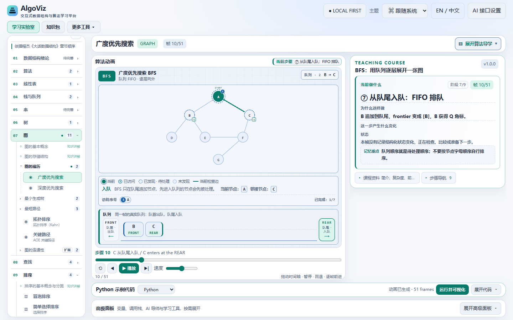
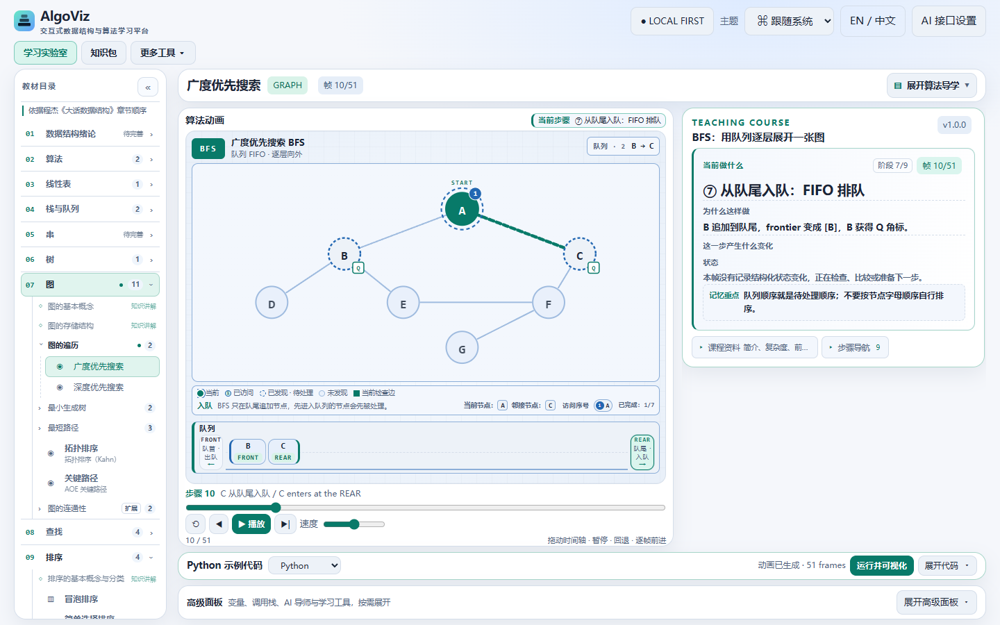
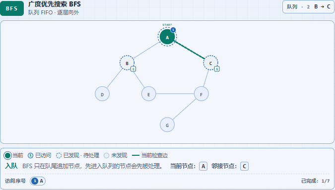
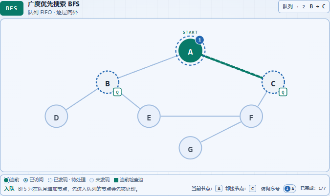
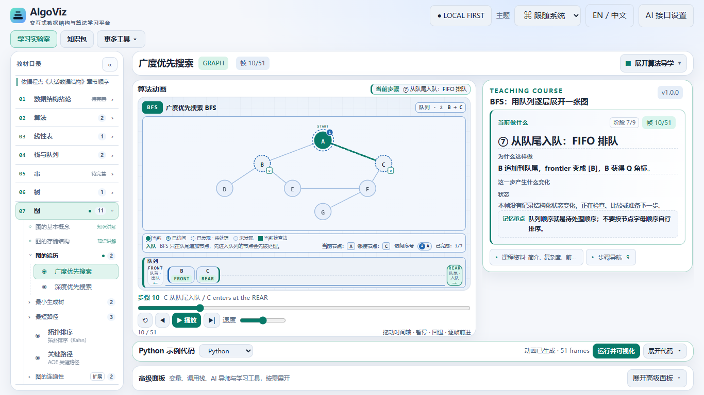
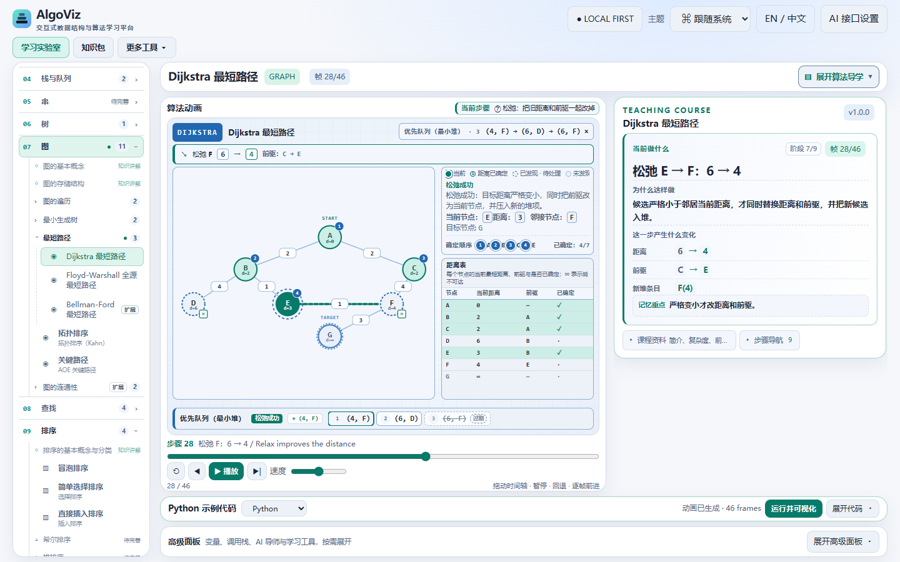
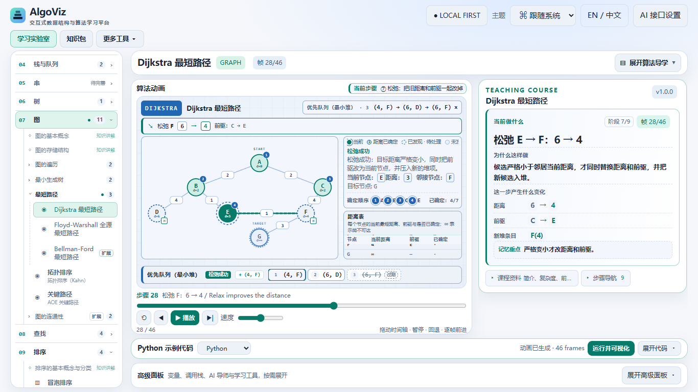
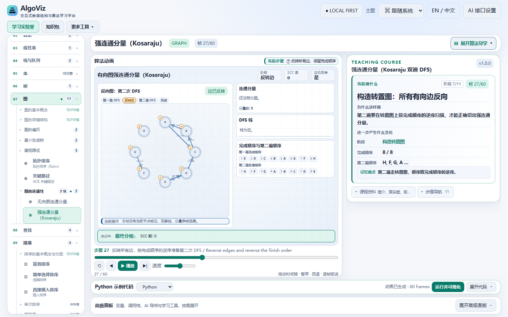

# UX-04C — 图算法画布尺寸与空间分配修复

- 版本：`0.19.2-ux04c`
- 分支：`feat/ux04c-graph-canvas`
- 基线：`c2865ee feat(ux03b): collapse single-algorithm textbook topics`
- 范围：只修复图算法可视化尺寸；未改导学、教材目录、右侧讲解、算法、Python Worker、Trace Schema，也未新增播放器或算法。

## 1. 问题定位

BFS 的图形过小不是单一 CSS 高度造成的，而是三处叠加：

1. `graphLayout.ts` 固定返回 `580 × 380` 布局，7 个节点的真实内容边界只有约 `401 × 351`，左右和上下都有大块空白。
2. `GraphVisual.tsx` 使用固定的 `viewBox="0 0 580 380"` 和默认 `xMidYMid meet`，SVG 永远按整张 580×380 的“纸”缩放，节点只占其中一小块。
3. `.graph-svg` 受 `max-height: 300px` 限制，且 `.graph-canvas-scroll` 作为可压缩 flex 子项在短屏被继续压扁。真实浏览器里 1440×900 的 SVG 显示框只有 `672 × 237`，1366×768 只有 `626 × 105`，节点 body 直径仅约 `28.7px` / `12.7px`。

因此只检查 SVG 元素宽度会误判为“已经铺满”；实际节点尺寸由固定 viewBox 和纵向压缩共同决定。

## 2. 修复方案

### 2.1 内容驱动的 viewBox

`src/domain/visualization/graphLayout.ts` 新增纯函数 `computeGraphViewBox(nodes, edges, radius)`：

- 把节点圆、标签宽度、START/TARGET 标签、visit/frontier/current ring 的余量纳入边界。
- 把边端点、箭头可达区域、边权标签 `34 × 20` 纳入边界。
- 四周保留 `10` SVG user unit 外边距，避免节点和箭头被裁切。
- 极小图使用 `240 × 180` 最小视口，避免单节点被放大到失控；空图回退固定尺寸。
- 默认 7 节点图的实际 viewBox 从 `0 0 580 380` 收紧为 `-16 -23 527 304`。

默认教学图的固定坐标同时改为更宽、更扁的确定性分布（A 300,40；B 130,105；C 470,105；D 25,175；E 215,175；F 425,175；G 300,240），让宽画布真正被节点分布利用。坐标是静态的，不随帧变化。

### 2.2 SVG 按可用画布自适应

`GraphVisual.tsx`：

- 使用 `model.viewBox`，显式 `preserveAspectRatio="xMidYMid meet"`。
- SVG 宽高使用紧凑 viewBox 尺寸，不再按 580×380 固定比例缩放。
- 增加 `data-testid="graph-canvas-scroll"`、`data-viewbox-width/height` 供真实浏览器测量。

没有使用 `transform: scale()` 强行放大整个 SVG；缩放完全来自 viewBox、SVG 尺寸和固定布局。

### 2.3 图区域高度与紧凑信息栏

`ux04.css` 仅针对 BFS/DFS 非加权图：

- 桌面画布高度 `clamp(240px, 35vh, 330px)`；1440×900 实测 `315px`。
- 短屏 `(min-width:1280px) and (max-height:800px)` 使用 `clamp(200px, 29vh, 240px)`；1366×768 实测 `222.7px`。
- SVG 改为 `width:100%; height:100%; max-height:none`，不再被压缩。
- 图例、当前动作、提示、访问序号合并成两行紧凑信息栏，高度从约 80px 级降到 `43px`（1366 为 `36.8px`）。
- 队列/栈保留，队列 lane、队列项、栈项压缩；1366 队列总高 `60.7px`，完整落在 stage 内。
- 队列“出队”元素在紧凑模式下改为 lane 左侧的内联小卡片，不再额外占一行，避免含出队帧把队列顶出播放控制。

### 2.4 其他图算法

- Dijkstra 与 BFS/DFS 共用同一 `computeGraphViewBox`，边权标签进入边界计算。
- 边权框从 `30×19` 调整为 `34×20`，字号从 `10.5px` 调到 `13px`，避免带权标签过小或裁切。
- Kosaraju/SCC、Kahn、Prim/Kruskal、Floyd/Bellman 继续使用各自现有渲染器；本次只通过默认坐标和 `GraphVisual` 影响共享布局，回归截图与冒烟测试覆盖。

## 3. 真实前后对比

相同算法、相同帧、相同分辨率；before 来自基线构建，after 来自当前构建。

| 场景 | before | after |
| --- | --- | --- |
| BFS 1440×900，frame 10/51 | SVG `672×237`，节点直径约 `28.7px`，节点分布宽约 `250px` | SVG `672×303`，节点直径 `45.85px`，节点分布宽 `494.4px` |
| BFS 1366×768，frame 10/51 | SVG `626×105`，节点直径约 `12.7px`，节点分布宽约 `111px` | SVG `626×211`，节点直径 `31.89px`，节点分布宽 `343.8px` |
| BFS 1366 队列 | 队列与状态区曾被压扁/重叠 | 队列 `60.7px` 高，底部 `560.3 < stage 565.3`，播放控制底部 `653.5 < 768` |
| Dijkstra 1440×900，frame 28/46 | 图集中在固定 580 画布中央 | 节点直径 `36.5px`，图内容宽 `393.6px`，距离表 7 行、优先队列完整 |
| Dijkstra 1366×768 | — | 节点直径 `33.55px`，图内容宽 `361.75px`，7 条边权均未被裁切，距离表可滚动到最后一行 |
| Kosaraju 1440×900，frame 27/60 | SCC stage 截图 | 与 before 字节级一致（`194840` bytes），布局未变 |
| Kosaraju 390×844 | SCC 全页截图 | 与 before 字节级一致（`321588` bytes），无页面级横向溢出 |

### BFS 1440

Before：

After：

图形卡前后：

### BFS 1366

Before：

After：

### Dijkstra 1440 / 1366 回归

### Kosaraju 1440 / 390 回归

## 4. 验收与门禁

- `npx tsc -b --pretty false`：通过。
- `npx vitest run`：87 个文件、723 个测试通过。
- `npm run build`：通过，`1437 modules transformed`。
- 正式 `e2e/ux04c.spec.ts`：4/4 通过，真实浏览器断言节点直径、节点分布宽高、viewBox、边权包含、队列/stage/playback、侧边栏折叠、前进/回退/跳帧布局稳定。
- 全量 Playwright：125/125 通过（因单次运行时间上限分两批执行，未跳过任何 spec）。
- 390 手机端：BFS/DFS 与 SCC 均无页面级横向溢出。

正式 E2E 不把 SVG 宽度作为验收信号，而是从节点 body 的真实屏幕直径、`.graph-nodes` 的显示 bbox、viewBox、队列与播放控制几何共同断言。

## 5. 边界确认

- 未修改顶部导学、教材目录、右侧讲解内容。
- 未新增算法、播放器或图论定理可视化。
- 未修改 Python Worker、Trace Schema。
- 未删除队列、栈、距离表或优先队列。
- 修复完成后停止，不继续其他 UI 功能。
