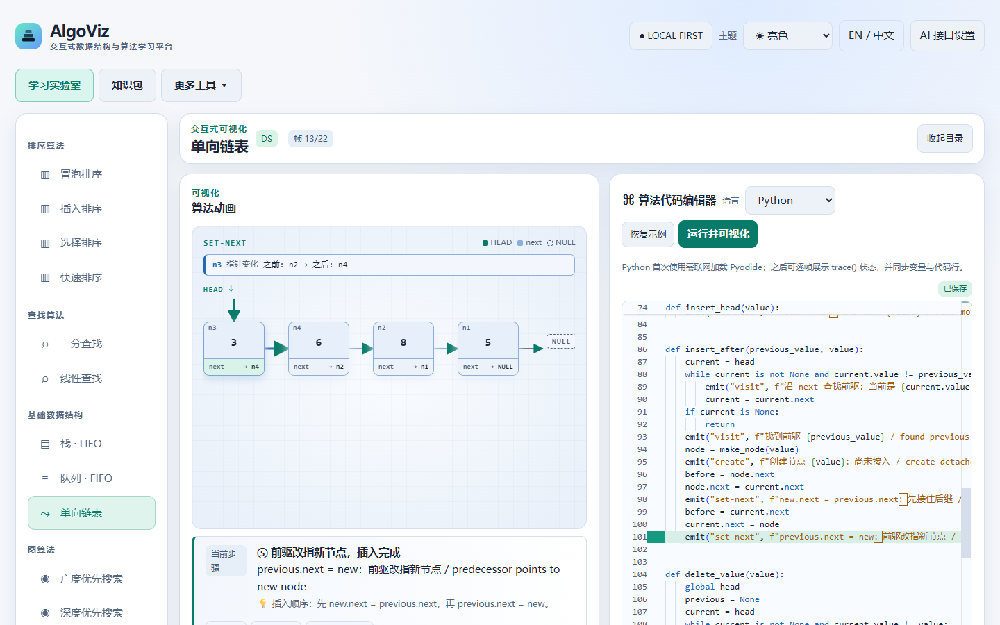
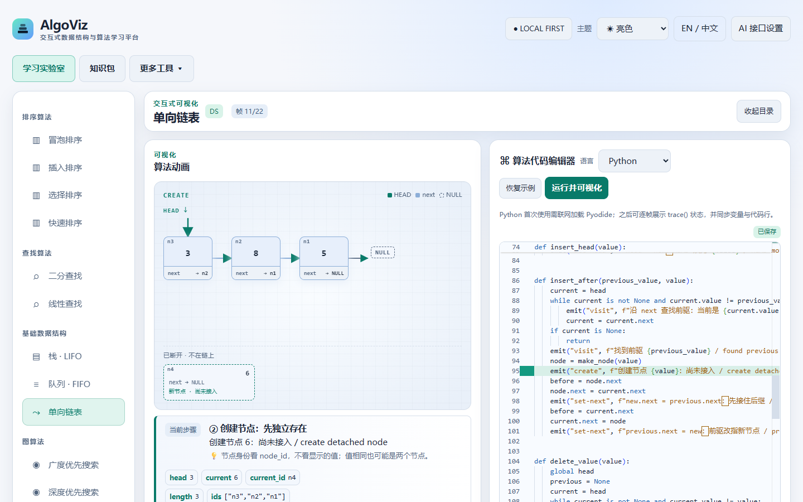
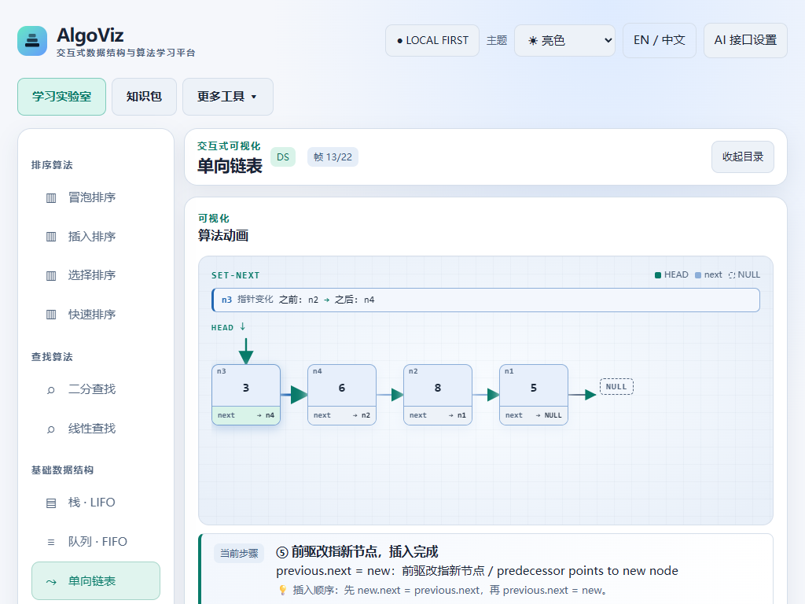
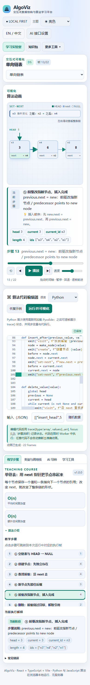
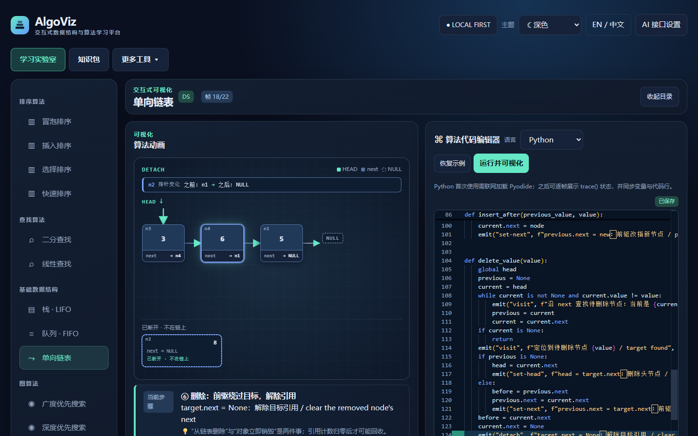

# AlgoViz Stage 7C 阶段报告：单链表专属可视化

- 报告日期：2026-11-16
- 版本：`0.9.0-phase7c`
- 分支：`main`
- 远端：`https://gitee.com/vvvi734/algolens.git`（未修改）
- 起始 HEAD：`47c6951 docs(stage7b): record post-delivery auto-run fix`
- 功能与文档提交：`0ab61cd`（见 J 节）

---

## A. 28 项验收矩阵

| # | 验收要求 | 状态 | 证据 |
| --- | --- | --- | --- |
| 1 | 新增真实单链表节点对象示例 | ✅ | `linkedListExamples.ts` 使用真实 `class Node(node_id, value, next)`；默认 22 帧由 Pyodide 执行 |
| 2 | 节点具有稳定身份 ID | ✅ | `node_id` 由 `make_node()` 生成 `n1/n2/...`；不使用 Python `id()`；同值输入 `3,5,3` 在 frame 8 仍为 n3(3)→n2(5)→n1(3) |
| 3 | `next` 是实际 Python 引用 | ✅ | Python 侧 `node.next = current.next` / `previous.next = node`；每帧 `node_json()` 序列化 `nextId` |
| 4 | Trace 包含结构化节点与指针状态 | ✅ | `kind:'linked-list'`、`operation`、`headId`、`nodes[]`、`targetId?`、`change?`；完整快照逐帧记录 |
| 5 | 无需解析 message 就能渲染 | ✅ | 操作、可达链、箭头、临时/断开状态全部来自 `event.structure`；组件不读 `message` |
| 6 | HEAD 与 NULL 正确 | ✅ | `linked-head` 向下箭头、`linked-null` 尾部框、空表 `HEAD → NULL`；E2E 断言 `data-node-id` |
| 7 | 新节点创建可视化正确 | ✅ | frame 10/11 的 n4 位于主链下方托盘，标为“新节点 · 尚未接入”，next 从 NULL→n2 后再接入 |
| 8 | 中间插入指针变化可视化正确 | ✅ | create(n4) → `new.next = previous.next` → `previous.next = new`，对应 frame 10/11/12，帧徽章显示 `n3 之前 n2 → 之后 n4` |
| 9 | 删除指针重连正确 | ✅ | frame 16 `n4.next = n1` 绕过 n2；frame 17 `n2.next = None` 后 n2 进入“已断开 · 不在链上” |
| 10 | 遍历访问高亮正确 | ✅ | frame 18/19/20 依次高亮 n3/n4/n1；frame 21 done 无 active；变量 `current/current_id` 同步 |
| 11 | 相同值节点不会混淆 | ✅ | E2E 自定义 `insert_head 3, 5, 3`：n1 与 n3 的 `data-value` 均为 3，但 ID、next 与箭头目标不同 |
| 12 | 时间轴回退正确 | ✅ | frame 17 回退到 frame 15，n2 恢复为可达节点、托盘清空、箭头恢复 3→6→8→5 |
| 13 | 任意跳帧正确 | ✅ | `setFrame` 直接把 `currentEvent` 换成目标帧；E2E 从 0 直接跳 8/10/11/12/15/16/17/18/19/20/21 |
| 14 | 播放/暂停/步进/快速拖动无残留 | ✅ | 播放状态仍由既有纯函数状态机持有；渲染器无计时器、无本地索引；快速切换只替换快照 |
| 15 | 变量与调用栈不回归 | ✅ | `head/current/current_id/length/ids` 逐帧真实；全量 Stage 3 调用栈测试通过 |
| 16 | Monaco 行高亮准确 | ✅ | `sourceLocation.line` 为 77/81/83/89/93/95/98/101/109/114/117/121/124/146/150/165；E2E 断言 Monaco active line + 源码快照第 146 行 |
| 17 | LessonPanel 同步 | ✅ | 8 个 `lessonStepId` 与 Python `lesson_step=` 完全一致；E2E 断言 `linked-active-step` 为 insert/traverse/done |
| 18 | 双语课程完整 | ✅ | `linked-list-pointer-basics` 中英各 8 步，覆盖 Node 身份、HEAD/NULL、插入顺序、删除重连、GC 区分、遍历、复杂度与常见错误 |
| 19 | 三态主题正常 | ✅ | Light/Dark 截图各 30 张；System 沿用既有 ThemeProvider；令牌契约测试通过 |
| 20 | 响应式正常 | ✅ | 1440 四节点完整可见；1024 主列全宽完整可见；390 画布内横向滚动并显示“左右滑动查看整条链”；三视口无页面级横向溢出 |
| 21 | Reduced Motion 正常 | ✅ | `prefers-reduced-motion: reduce` 关闭节点进入/过渡动画；E2E 断言徽章与断开节点仍可见 |
| 22 | 旧算法、栈与队列不回归 | ✅ | 14 个算法帧快照、Stage 1–7B E2E、栈/队列 7 帧与回退全部通过 |
| 23 | TypeScript 通过 | ✅ | `npm run typecheck` 0 错误 |
| 24 | 单元测试通过 | ✅ | 55 文件 / **434 tests** 全绿（基线 405 + 29 新增） |
| 25 | Build 通过 | ✅ | `npm run build` 成功；`dist/index` 540.37 kB / gzip 171.29 kB |
| 26 | 真实浏览器 E2E 通过 | ✅ | 全量 **32 / 32**；其中 Stage 7C 6 条真实 Pyodide 测试；首轮曾遇 CDN 抖动，单独复跑与整轮复跑均通过 |
| 27 | MCP 与 AI Gateway 回归通过 | ✅ | MCP 20/20；AI Gateway 26/26；两者 typecheck 通过；legacy 14 帧随单测通过 |
| 28 | 真实截图、报告与 Git 完整 | ✅ | `docs/stage7c/after/` 60 张真实截图；本报告；正常 commit / push，记录见 J 节 |

> 说明：任务建议官方示例覆盖“头部/尾部/中间插入、删除、遍历”。默认 22 帧覆盖头部、中间、删除、遍历；`insert_tail` 已实现并可由自定义输入触发，但没有塞进默认 22 帧（取舍见 I 节）。这不影响中间插入这一核心教学目标。

---

## B. 单链表模型与 Trace 设计

### B1. 数据流

```text
真实 Python Node 对象
  Node(node_id, value, next)
        │  emit(...) 每帧一次
        ▼
payload = {
  kind: 'linked-list',
  operation,
  headId,
  nodes: [{ id, value, nextId }],
  targetId?,
  change?: { nodeId, beforeNextId, afterNextId }
}
        │  trace(..., structure=payload)
        ▼
Pyodide Worker frame.structure
        │  structureSchema.safeParse (union)
        ▼
TraceEvent（唯一 currentEvent）
        │
        ▼
buildVisualModel → linkedListModel.ts（纯函数）
        │  主链只由 headId→nextId 推导
        ▼
VisualStage → LinkedListVisual（无状态 SVG/DOM 渲染）
```

### B2. 节点身份与快照

- 节点是 `{ id, value, nextId }`。`id` 是教学用的稳定身份，不是数组下标，也不是 Python `id()`。
- `nodes` 是**当前 Python 程序仍持有的全部 Node**，可以包含尚未接入的新节点、刚断开的节点；数组顺序不决定主链。
- `headId` 为 `null` 表示空链表；主链严格从 `headId` 沿 `nextId` 走到 `null`。
- `linkedListModel.ts` 将主链节点放入 `nodes`，将不可达节点放入 `detachedNodes`；状态分为：
  - `temporary`：`create` / 尚未接入的 `set-next` 目标；
  - `detached`：曾接入、当前不可达的节点。
- 空链表、HEAD 变化、同值不同 ID、临时节点、断开节点都由快照直接表达，渲染层不推断。

### B3. 操作与指针变化

`operation` 固定为 `init | create | set-next | set-head | visit | detach | done`。

`change` 只在 `set-next` 与 `detach` 出现，记录真实赋值：

```ts
{
  nodeId: string,
  beforeNextId: string | null,
  afterNextId: string | null
}
```

约束：

- `set-next` / `detach` 必须带 `change`；
- `detach` 的 `afterNextId` 必须为 `null`；
- `change.afterNextId` 必须等于该节点在快照中的最终 `nextId`；
- `targetId` 在带 `change` 的帧必须等于 `change.nodeId`；
- `create` / `visit` / `set-next` / `detach` 必须提供 `targetId`。

### B4. Schema 校验

`structureSchema = z.union([structureSnapshotSchema, linkedListSnapshotSchema])`，旧 stack/queue 结构原样保留。`linkedListSnapshotSchema` 拒绝：

- 重复节点 ID；
- `headId` / `nextId` / `targetId` 指向不存在的节点；
- 任何环，包括只在 detached 节点之间形成的环；
- 超过 40 个节点；
- `set-next` / `detach` 缺少 `change`；
- `change` 与节点最终 `nextId` 不一致；
- `detach` 未记录 `next = null`。

校验失败时 adapter 整块丢弃 structure，保留 legacy 视图，不会半应用。旧 JS 的 `linked` 数组帧仍走 `nodes` 数组视图，不回归。

---

## C. Python 示例

`LINKED_PYTHON` 使用真实 Node 对象，不使用 Python list 冒充链表：

```python
class Node:
    def __init__(self, node_id, value):
        self.node_id = node_id
        self.value = value
        self.next = None
```

- `make_node()` 生成 `n1/n2/...` 并加入全局 `nodes`；
- `chain_nodes()` 从 `head` 沿真实 `next` 生成可达链；
- `node_json()` 每帧生成 `{id, value, nextId}`，不直接 JSON 化 Node；
- `emit()` 写入 `variables`：`head`、`current`、`current_id`、`length`、`ids`；
- `state = {type:'linked', values:[主链值], focus:[targetId]}`；
- 默认输入：

```json
[["insert_head",5],["insert_head",8],["insert_head",3],["insert_after",3,6],["delete",8],["traverse"]]
```

最终链：`3 → 6 → 5 → NULL`，真实执行 **22 帧**。

### C1. 22 帧快照

| 帧 | 操作 | 可达主链 | target | change | 行号 | lesson |
| --- | --- | --- | --- | --- | --- | --- |
| 0 | init | 空 | — | — | 150 | init |
| 1 | create | 空 | n1(5) | — | 77 | create |
| 2 | set-head | 5 | n1 | — | 83 | insert |
| 3 | create | 5 | n2(8) | — | 77 | create |
| 4 | set-next | 5 | n2 | n2: null→n1 | 81 | connect |
| 5 | set-head | 8→5 | n2 | — | 83 | insert |
| 6 | create | 8→5 | n3(3) | — | 77 | create |
| 7 | set-next | 8→5 | n3 | n3: null→n2 | 81 | connect |
| 8 | set-head | 3→8→5 | n3 | — | 83 | insert |
| 9 | visit | 3→8→5 | n3 | — | 93 | find |
| 10 | create | 3→8→5 | n4(6) | — | 95 | create |
| 11 | set-next | 3→8→5 | n4 | n4: null→n2 | 98 | connect |
| 12 | set-next | 3→6→8→5 | n3 | n3: n2→n4 | 101 | insert |
| 13 | visit | 3→6→8→5 | n3 | — | 109 | find |
| 14 | visit | 3→6→8→5 | n4 | — | 109 | find |
| 15 | visit | 3→6→8→5 | n2 | — | 114 | find |
| 16 | set-next | 3→6→5 | n4 | n4: n2→n1 | 121 | unlink |
| 17 | detach | 3→6→5 | n2 | n2: n1→null | 124 | unlink |
| 18 | visit | 3→6→5 | n3 | — | 146 | traverse |
| 19 | visit | 3→6→5 | n4 | — | 146 | traverse |
| 20 | visit | 3→6→5 | n1 | — | 146 | traverse |
| 21 | done | 3→6→5 | — | — | 165 | done |

关键帧解释：

- **frame 10**：n4 已创建，next 仍为 NULL，不在主链；
- **frame 11**：n4.next 指向 n2，主链尚未指向 n4；
- **frame 12**：n3.next 由 n2 改为 n4，插入完成；
- **frame 16**：n4.next 由 n2 改为 n1，主链绕过 n2；
- **frame 17**：n2.next 被主动清空；n2 仍存在于 `nodes`，只是从 HEAD 不可达。

### C2. 其他输入

- 自定义 `[["insert_head",3],["insert_head",5],["insert_head",3]]`：10 帧，frame 8 主链 `n3(3)→n2(5)→n1(3)`。
- `insert_tail` 分支已在 Python 中实现并可被自定义输入调用；默认 22 帧未使用它，以把动画重点放在中间插入、删除和遍历。取舍见 I 节。

---

## D. 视觉实现

### D1. 节点与箭头

- 节点：左侧 `node_id`、上方数据格、下方 `next → nX / NULL` 格；数据格与 next 格有独立边框和底色。
- 箭头：SVG `<line>` + `<marker>`，每条边输出 `data-from-id` / `data-to-id`；只有真实 `nextId` 才产生箭头。
- HEAD：左上 `HEAD ↓`，箭头指向 `headId` 对应节点。
- NULL：尾节点右侧虚线框 + 虚线箭头；空链表显示 `HEAD → NULL`。
- 临时节点：主链下方托盘，虚线边框，标记“新节点 · 尚未接入”。
- 断开节点：仍保留 ID、值和当前 next，标记“已断开 · 不在链上”；不伪造垃圾回收。
- 指针变化徽章：显示 `nodeId`、`之前: old`、`→`、`之后: new`；changed 节点与 changed 边使用强调色。

关键 DOM 属性（E2E 直接断言）：

- 节点 `linked-node`：`data-node-id` / `data-value` / `data-next-id` / `data-role` / `data-reachable` / `data-status` / `data-active` / `data-changed`
- 箭头 `linked-edge`：`data-from-id` / `data-to-id` / `data-changed`
- HEAD `linked-head`、NULL `linked-null`、断开节点 `linked-detached-node`、变化徽章 `linked-change`
- 窄屏滚动提示 `linked-scroll-hint`

### D2. 布局

- 常量：`NODE_W=88`、`NODE_H=78`、`GAP=34`、`NODE_TOP=58`、`SVG_H=150`。
- 4 节点主链总宽 526px：1440 三列布局下可完整显示；1024 主列全宽可完整显示。
- 390 下使用 `.linked-scroller` 内部横向滚动，页面本身不横向溢出；显示“左右滑动查看整条链”提示。
- 断开/临时节点使用独立托盘，不挤占主链槽位，避免主链位置跳动。
- `prefers-reduced-motion: reduce` 关闭节点进入动画与颜色/边框过渡，保留文字、边框、箭头与角色标签。

### D3. 状态与播放

- `LinkedListVisual` 是无状态渲染器：不持有播放索引，不复制节点状态，不通过 message 推断关系。
- 播放/暂停/步进/拖动继续使用 `useTracePlayer` 的单一 `currentEvent`；跳帧直接渲染目标快照。
- CSS 过渡只负责呈现，不创造状态；回退与快速拖动不会残留旧节点或旧箭头。

---

## E. 教学课程

| 字段 | 值 |
| --- | --- |
| lessonId | `linked-list-pointer-basics` |
| algorithmId | `linked` |
| contentVersion | `1.0.0` |
| 注册顺序 | bubble、factorial、stack、queue、linked |

8 个 stepId 与 Python `lesson_step=` 完全一致：

| stepId | 中文标题 | 主要教学点 |
| --- | --- | --- |
| `init` | ① 空链表与 HEAD → NULL | 空表合法、HEAD 是引用 |
| `create` | ② 创建节点：先独立存在 | 新节点已有身份，但尚未接入 |
| `find` | ③ 查找前驱：沿 next 走 | 逐节点前进，current/current_id |
| `connect` | ④ 新节点先接住后继 | `new.next = previous.next` |
| `insert` | ⑤ 前驱改指新节点，插入完成 | `previous.next = new` |
| `unlink` | ⑥ 删除：前驱绕过目标，解除引用 | `previous.next = target.next`，再 `target.next = None` |
| `traverse` | ⑦ 遍历：从 HEAD 一路走到 NULL | 读取值，再 `current = current.next` |
| `done` | ⑧ 演示结束与复杂度 | 最终链、O(1)/O(n)、常见错误 |

课程覆盖：

- 单链表不是数组、节点由 value + next 组成；
- HEAD / NULL 与空链表；
- 为什么插入必须先接后继、再改前驱；
- 为什么删除要重新连接前驱与后继；
- “从链表删除”不等于“Python 对象立即销毁”；
- 如何遍历、同值节点按 node_id 区分；
- 头部插入 O(1)，按值查找/中间插入/删除/遍历 O(n)；
- 常见错误（先改前驱、用值判断身份、忘记保存 target.next、忘记推进 current）。

中英文均为完整原创文案；保留既有步骤点击跳转与高亮逻辑。选中 `linked` 时默认 Python；切回 JavaScript 仍可运行 legacy 数组示例。

---

## F. 时间轴与状态恢复

- **任意跳帧**：时间轴/`setFrame` 只改变 `currentEvent`，`linkedListModel` 从该帧快照重新计算可达链与断开节点；不存在“播放到第 10 帧”的中间状态。
- **回退**：例如 frame 17 → 15，快照中的 n2 重新成为可达节点，`detachedNodes` 为空，箭头恢复 n2→n1；E2E 明确断言。
- **快速拖动**：Renderer 没有独立计时器，CSS transition 不会累积；每次 render 的 DOM key 为节点 ID，React 只更新属性。
- **切换算法**：`selectAlgo` 重新运行并替换 Trace；切到 stack/queue 后 `linked-visual` DOM 数量为 0，旧链表节点不残留。
- **Reduced Motion**：动画关闭，但数据变化、文字、边框、角色标签仍完整。

---

## G. 视觉证据

截图由 `e2e/stage7c.spec.ts` 在真实 Pyodide 运行后落盘到 `docs/stage7c/after/`：

- 10 个状态：`empty`、`initial`、`create`、`next-connected`、`inserted`、`delete-before`、`delete-bypass`、`delete-after`、`traverse`、`rollback-restored`
- 3 个宽度：1440×900、1024×768、390×844（fullPage）
- 2 个主题：light / dark
- 合计 **60 张真实截图**

**1440 Light：中间插入完成**



**1440 Light：新节点刚创建（主链下方托盘）**



**1024 Light：四节点完整可见**



**390 Light：画布内滚动提示**



**1440 Dark：删除后 n2 断开、next 清空**



### 视觉检查结论

- 箭头确实连接 `data-from-id → data-to-id` 的真实节点，不是装饰线；
- HEAD 箭头指向 `headId`；尾部 NULL 与 n1 的 `next → NULL` 同时可见；
- 同值不同 ID 在截图与 DOM 属性中都可区分；
- 新节点在托盘，不遮挡主链；删除后 n2 的 ID、值和 `next → NULL` 保留；
- 1440/1024 四节点完整可见；390 需要画布内横向滚动，但有明确文字提示；
- Light/Dark 下节点、next 格、箭头、HEAD/NULL 与变化徽章均有独立边框/文字，不只靠颜色；
- 三视口 `scrollWidth <= clientWidth + 1`，无页面级横向溢出；Monaco 保留合理宽度。

---

## H. 测试结果

| 门禁 | 命令 | 结果 |
| --- | --- | --- |
| TypeScript | `npm run typecheck` | **0 错误** |
| 单元/组件 | `npm test -- --reporter=dot` | **55 文件 / 434 tests 通过** |
| 构建 | `npm run build` | **成功**；`dist/index` 540.37 kB / gzip 171.29 kB |
| 浏览器 E2E | `npx playwright test --reporter=line` | **32 / 32 passed**（约 5 分钟） |
| Stage 7C E2E | `npx playwright test e2e/stage7c.spec.ts` | **6 / 6 passed**（约 1.6 分钟） |
| MCP 协议 | `npx vitest run packages/mcp-server` | **20 / 20 通过** |
| AI Gateway | `npx vitest run packages/ai-gateway` | **26 / 26 通过** |
| 子包类型 | `npm run mcp:typecheck` / `npm run ai:typecheck` | 通过 |
| 帧回归 | 随 `npm test` | 14 个算法逐帧基线通过 |
| 可访问性 | axe-core | **未安装、未执行**；见 I 节 |

### 新增测试（29 项）

- `src/domain/trace/linkedList.test.ts`（10）：合法/空表/重复 ID/悬空引用/相同值不同 ID/临时节点/环/40 上限/缺失 change/change 不一致。
- `src/domain/visualization/linkedListModel.test.ts`（8）：主链由 nextId 而非数组顺序、HEAD 改变、临时/断开节点、空表、HEAD → NULL。
- `src/features/lab/LinkedListVisual.test.tsx`（6）：节点数据/next 格、箭头目标、HEAD/NULL、断开托盘、变化徽章、同值不同 ID。
- `src/domain/algorithms/linkedListExamples.test.ts`（5）：真实 Node 对象、`next` 引用、中间插入、删除、遍历与历史快照。
- 另修正旧课程数量断言：内置课程 5 门；未覆盖算法数 9。

### Stage 7C E2E（6 条）

1. `builds 3 -> 8 -> 5 and shows create, set-next and predecessor insertion`：DOM 节点顺序/值/箭头、临时节点、change 徽章、lesson step。
2. `bypasses the deleted node, clears its next and restores state on scrub back`：绕过、detach、回退恢复。
3. `traverses from HEAD to NULL with real variables, line and lesson step`：frame 18/19/20 active 节点、变量、Monaco line 146、源码快照。
4. `keeps equal values distinct and returns to stack/queue without stale linked DOM`：同值不同 ID、切栈/队列无旧 DOM。
5. `1440/1024/390 light/dark screenshots for every linked-list teaching state`：60 张真实截图。
6. `1024 and 390 keep the linked canvas readable with no page overflow and reduced motion`：无页面溢出、390 滚动提示、Reduced Motion。

### 测试时序说明

全量 E2E 首轮出现一次外部网络抖动：`importScripts('https://cdn.jsdelivr.net/pyodide/.../pyodide.js')` 加载失败，导致 mentor 测试的冒泡运行没有产物；单独复跑该测试 1/1 通过，整轮复跑 32/32 通过。该失败与 Stage 7C 代码无关，但说明真实 Pyodide E2E 仍受 CDN 可用性影响。

---

## I. 已知问题

1. **尾部插入未纳入默认 22 帧**：`insert_tail` 已在 Python 实现并可通过自定义输入触发；默认流程优先演示中间插入、删除和遍历。后续可在不增加复杂度的前提下加入默认流程或单独示例。
2. **390 不能一次看完整条四节点链**：使用画布内横向滚动 + “左右滑动查看整条链”提示，页面无横向溢出；这是受控的窄屏策略，不是所有节点同时可见。
3. **不支持双向链表、循环链表、树、图**：本阶段明确不做；Schema 对环一律拒绝并安全降级，不会无限遍历。
4. **节点上限 40**：沿用了结构 payload 的统一上限；超出时 Schema 拒绝，保留 legacy 视图。
5. **axe-core 未执行**：仍没有自动化无障碍门禁；键盘、焦点与对比度由人工检查和既有 Stage 7A E2E 覆盖，不能宣称全站无障碍已解决。
6. **Monaco Worker 技术债**：`ts.worker` 仍约 7 MB，语言服务提示与打包体积未重构。
7. **真实 AI 未验证**：AI Gateway 回归使用 mock provider；真实 Ollama / 云端模型仍未实测。
8. **队列出队轻微跳动**：Stage 7B 记录的已有债务，未在本阶段处理。
9. **内部旧品牌标识**：`algolens` package name、持久化 key、MCP Tool、AI 环境变量按兼容策略保留；用户可见品牌已是 AlgoViz。
10. **移动端代码长行**：Monaco 内部横向滚动，页面无溢出，但单行阅读仍受屏幕宽度限制。

---

## J. Git 状态

- 分支：`main`
- 远端：`origin https://gitee.com/vvvi734/algolens.git`（未修改）
- 起始 HEAD：`47c6951`
- 功能与文档提交：`0ab61cd`
- 报告哈希回填提交：紧随其后的 docs 回填提交；为避免哈希递归，正文不记录该提交自身哈希，可用 `git log -1 --format=%h` 核对
- 工作区：docs 回填提交后 clean
- 推送：`git push origin main`，结果见交付说明

本阶段未使用 `git reset --hard`、`git clean -fd`、强推或改写历史。

---

## K. 下一阶段评估（只评估，不实现）

1. **双向链表**：需要新增 `prev` 引用与稳定边身份；删除时同时重连两侧，不能靠节点数组顺序推断。
2. **树的布局**：二叉树层级、访问路径与子树高亮；需要独立布局算法，不能套用链表水平槽位。
3. **图渲染**：BFS/DFS 节点、边与队列状态联动；应复用现有 `currentEvent` 与队列语义，而不是另建播放器。
4. **环形链表教学**：必须先定义“检测到环”的安全协议与可视化策略，不能直接让布局/遍历无限循环。
5. **技术债优先级**：axe-core、Monaco worker 体积、真实模型验证、移动端长行阅读，均需独立阶段处理。

这些方向都需要新的 Trace 字段、真实 Python 示例、课程与视觉验收，不能在 Stage 7C 内提前实现。
